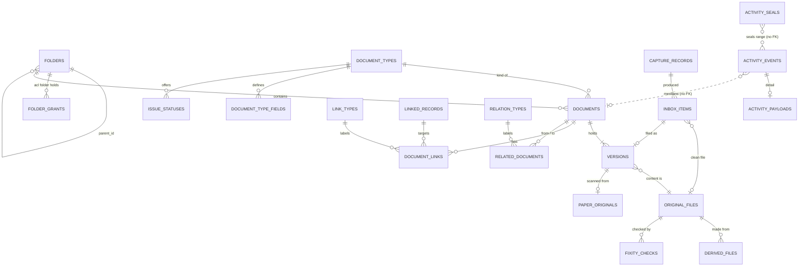

# R17 — Data model and ERP integration contract

- **Status:** First pass, design-level. Research only, no code; the SQL and PHP below are sketches. **Written without access to the Officetul code**, so every table and contract here is checked against the real code in the D-013 design review. §11 lists what to check.
- **Researched:** 2026-10-20. **All sources accessed 2026-10-20.**
- **Question:** What data model and integration contract should the Documents app have inside Officetul, on MySQL 8.4 and Laravel 13?
- **Labels:** **Verified fact** (read in the primary source), **Vendor claim**, **Secondary** (news, a third party or a search excerpt only), **Estimate**, **Open question**, **Recommendation** (proposed, not approved). Source IDs `[S#]` point to §14.

**Scope note.** PROJECT-CONTEXT.md says the DMS "must not depend on sharing its database" so it stays "sellable on its own". **D-002, D-007 and D-010 supersede that line.** Documents is a native Officetul app: same database, login, tenancy and permission model. This note treats it that way. The Phase 9 "integration contract" is therefore a contract *between modules of one Laravel application*, not between two products.

**Access caveats.**
- Oracle's MySQL 9.7 LTS blog returned 403, so 9.7 dates come from a search excerpt and endoflife.date and are **Secondary**. Oracle's own support-policy page wasn't fetched. The 8.4 end dates are **Secondary** too. The rule behind them ("5 years of premier support and 3 years of extended support") is **Verified** in the MySQL manual [S12].
- The Odoo Documents app (`documents.document`) is Enterprise-only and its code isn't public. Only its user documentation was read [S36].
- Laravel facts were read in the 13.x docs and the `laravel/framework` 13.x source [S19]–[S27].
- The search engine choice (MySQL FULLTEXT, Meilisearch and others) is R16's job. §8 only touches it.

**Terms** follow [GLOSSARY.md](../GLOSSARY.md) exactly: Inbox item, Capture record, Document, Document type, Folder, Version, Original file, Derived file, Official version, Draft, Superseded, Withdrawn, Revision label, Issue status, Paper original, Link, Related document, Trash, Access level, Restricted folder, Confidential folder, Support access, Activity log, Security log, Log digest, Fixity check. "**Record**" means an Officetul business record owned by another app (an Expense, a Customer, a Project). "**Owning app**" is the app that owns that record (Accounting, CRM, …).

---

## 1. Summary

1. **Every Documents table carries `tenant_id`, a ULID primary key and a `UNIQUE (tenant_id, id)` key.** Child tables point at parents with **composite foreign keys** `(tenant_id, parent_id)`, so the database refuses cross-company references (D-052, R15 §1.4). MySQL 8.4 *requires* that unique key: by default it rejects foreign keys to non-unique or partial keys [S3]. *(Recommendation)*
2. **"At most one Official version" is enforced by the database.** A virtual generated column `official_doc_id = IF(state='official', document_id, NULL)` gets a `UNIQUE (tenant_id, official_doc_id)` index. MySQL allows unique indexes on virtual columns, and a unique index admits many NULLs [S1][S4]. This is the MySQL equivalent of PostgreSQL's partial unique index [S16]. *(Recommendation)*
3. **Versions and Original files are write-once.** The app has no update path for their content columns, and a `BEFORE UPDATE` trigger refuses changes as a backstop. Things that legitimately change, such as the version state, Paper original location and Fixity check results, live in separate columns or tables. *(Recommendation)*
4. **One stored Original file per tenant per SHA-256.** `UNIQUE (tenant_id, sha256)`. Never across tenants (D-042, R13 §10). When someone chooses "file anyway", two Versions share one Original file. *(Recommendation → Decision 2)*
5. **Document details are a JSON column validated against per-type field definitions.** Standard fields live in typed columns: document date, reference number, amount, expiry date, event date. Odoo and Frappe add a real column per custom field [S37][S43]; a shared multi-tenant table can't do that per company. *(Recommendation → Decision 3)*
6. **Folders are an adjacency list plus `acl_folder_id`** (R15 §5.2), walked with recursive CTEs where needed [S5]. No closure table or nested set in the MVP. *(Recommendation)*
7. **Links go through a small `linked_records` registry**, not a bare `morphTo`:
   - Each row is a stub for one Officetul record, holding its morph alias, its key and a label snapshot.
   - Links have real foreign keys to the stub.
   - When the record is deleted, the stub is flagged and the Document and its Link survive (Decision 1).
   - `Relation::enforceMorphMap` stops class names leaking into the database [S19][S20].
   *(Recommendation)*
8. **Integration contract:** each owning app registers a `LinkableRecordProvider`. The provider answers four questions:
   - what is this record called;
   - can this user open it;
   - which of these records can this user see, as a SQL subquery;
   - which Link types does it offer.

   Events flow both ways after commit [S24]. A React **Document panel** goes on record pages through an Inertia deferred prop [S29]. *(Recommendation)*
9. **Object storage:** separate buckets (or class-first prefixes) for quarantine, originals, derived, exports and digests. Object keys use random IDs, never fingerprints or filenames. The rule is **"object before row, row before delete"**, with idempotent promotion and orphan sweeps. *(Recommendation → Decision 5)*
10. **Scale (Estimate):** 100 tenants × 50,000 Documents comes to about **35 GB** of core tables, about **50 GB** more if OCR text sits in MySQL, and **18–150 GB a year** of Activity log. One MySQL 8.4 server handles that.
11. **MySQL vs PostgreSQL:** **no confirmed requirement needs PostgreSQL.** Every gap has a documented MySQL workaround: no row-level security, no partial indexes, no transactional DDL, weaker JSON indexing. Stay on MySQL (8.4 LTS or later LTS) unless the code review finds MariaDB or MySQL 8.0 (§8). *(Recommendation → Decision 6)*

---

## 2. Entity model

### 2.1 Conventions for every Documents table

| Convention | Detail | Label |
|---|---|---|
| `tenant_id` first | `NOT NULL`, same type as Officetul's company key (**Open question**, Q1/Q22). It leads every composite index, so a tenant's rows sit together in each index. | **Recommendation** |
| Primary key | `id CHAR(26)` ULID via Laravel `HasUlids`. That is `char(26)` on MySQL, and Laravel lower-cases the value [S21][S23]. ULIDs are time-ordered, so inserts append to the clustered index. The same ID works in URLs (D-052) and in foreign keys. | Laravel behaviour **Verified fact** [S21][S23]; choice **Recommendation** |
| Alternative | `HasUuids` gives **UUIDv7** by default in Laravel 13 (`Str::uuid7()`), stored as `char(36)` [S21][S23]. Also fine; ULID is 10 bytes shorter per key and per index entry. | **Verified fact**; preference **Estimate** |
| Character set for IDs | `CHARACTER SET ascii COLLATE ascii_bin` on ID columns, so a 26-character key costs 26 bytes, not up to 104 in utf8mb4. | **Estimate** (standard InnoDB sizing) |
| Tenant-safe foreign keys | Parent: `UNIQUE (tenant_id, id)`. Child: `FOREIGN KEY (tenant_id, parent_id) REFERENCES parent (tenant_id, id)`. Laravel's grammar compiles array columns in `foreign()`/`references()` [S22]. MySQL 8.4 rejects FKs to non-unique or partial keys by default (`restrict_fk_on_non_standard_key` is ON) [S3], so the unique key is mandatory. | **Verified fact** [S3][S22]; pattern **Recommendation** |
| No cascades | Foreign keys use the default RESTRICT. Deleting is an application action that also writes the Activity log (D-060), so a silent `ON DELETE CASCADE` would bypass the log. | **Recommendation** |
| Constraints are immediate | InnoDB checks unique and foreign keys row by row, never deferred to commit [S8]. Multi-row state swaps must update rows in a safe order (§2.4). | **Verified fact** [S8] |
| Times | `DATETIME(6)` in UTC (D-063) | Decided |
| Trash | `trashed_at`, `trashed_by`, `trash_reason`. Laravel's SoftDeletes can be pointed at `trashed_at` (`const DELETED_AT`). | **Recommendation** |
| CHECK constraints | Enforced by MySQL 8.4. No subqueries, stored functions or variables. A column can't be in both a CHECK and an FK referential action [S7]. **Laravel 13 has no `check()` schema method**, so they need `DB::statement` [S21]. | **Verified fact** [S7][S21] |

### 2.2 Tables

Columns are illustrative. Each table also has `tenant_id`, `id`, `UNIQUE (tenant_id, id)` and `created_at`/`created_by` unless noted. *(All rows: **Recommendation**.)*

**Configuration**

| Table | Key columns | Constraints and notes |
|---|---|---|
| `document_types` | `preset_key` (stable system key, e.g. `invoice_purchase`, `payment_receipt`; NULL for client-made types), `name`, `search_aliases` JSON ("OR", D-023), `default_folder_id`, `default_filing` (`official`/`draft`, D-036), `default_sensitivity`, `has_expiry`, `has_event_date`, `event_date_label`, `archived_at` | `UNIQUE (tenant_id, preset_key)`. Reports and integrations use `preset_key`, never names, because clients may rename types (D-024). |
| `document_type_fields` | `document_type_id`, `key`, `label`, `data_type` (`text`, `number`, `money`, `date`, `choice`, `tin`, `boolean`), `required`, `options` JSON, `filterable` (exact-match filter, §2.6), `sort`, `archived_at` | `UNIQUE (tenant_id, document_type_id, key)`. Fields are archived, never deleted, so old values stay readable. |
| `issue_statuses` | `document_type_id`, `label`, `sort`, `archived_at` | The Issue status pick-list per Document type (D-026 item 5) |
| `link_types` | `key`, `label` ("receipt for"), `inverse_label` ("receipts"), `record_type` (morph alias), `grants_view` **default 0** (D-020, D-053), `provided_by` (owning app), `system` | `UNIQUE (tenant_id, key)`. Seeded from provider registration (§4.1). The company admin may turn `grants_view` on. |
| `relation_types` | `key`, `label` ("amends"), `inverse_label` ("amended by") | Seeded with "amends" (D-040) |

**Folders and access**

| Table | Key columns | Constraints and notes |
|---|---|---|
| `folders` | `parent_id` (NULL = top level), `name`, `acl_folder_id`, `is_restricted`, `is_confidential`, `depth`, `trashed_at` | FK `(tenant_id, parent_id)` → `folders`. FK `(tenant_id, acl_folder_id)` → `folders`. Name unique among siblings via a generated `parent_key = COALESCE(parent_id, '-')`, because a plain unique index would let two NULL-parent folders share a name [S4]. `CHECK (is_confidential = 0 OR is_restricted = 1)` (D-055). Depth cap of about 20, well under `cte_max_recursion_depth` (default 1000) [S5]. |
| `folder_grants` | `folder_id` (always an ACL-holding folder), `grantee_type` (`role`/`user`), `grantee_id`, `level` (1 View, 2 Contribute, 3 Manage) | `UNIQUE (tenant_id, folder_id, grantee_type, grantee_id)`. Index `(tenant_id, grantee_type, grantee_id)`. No FK to roles or users until their tables are known (§11). |

**Capture**

| Table | Key columns | Constraints and notes |
|---|---|---|
| `capture_records` | `channel` (`upload`, `email`, `phone`, `record_attach`, later `request`), `captured_by`, `captured_at`, `ip`, `user_agent` (truncated), `sender_address`, `email_message_id`, `email_date`, `auth_results` JSON (SPF/DKIM/DMARC verdicts), `headers_object_key`, `headers_sha256`, `device_time` (EXIF, labelled as the device's clock, R14 §1.3) | Write-once. **The full email header block goes to object storage** (§5) with its hash in the row (D-031 "email headers kept"). The database keeps only the fields that are searched or shown. One email with three attachments is **one** Capture record and **three** Inbox items. |
| `inbox_items` | `capture_record_id`, `upload_key` (quarantine), `original_filename` (display only, NFC-normalised, R13 §2), `declared_size`, `pipeline_state` (`received`, `quarantined`, `clean`, `rejected`, `infected`, `held_for_review`, `processing_failed`, R13 §9–10), `review_state` (`open`, `filed`, `rejected`, `linked_to_existing`), `original_file_id` (set when clean), `filing_intent` JSON (§4.4), `assigned_to`, `filed_version_id`, `filed_at`, `filed_by` | Inbox items are never deleted when filed (Section 05 §6.3 #1). |

**Documents, Versions and files**

| Table | Key columns | Constraints and notes |
|---|---|---|
| `documents` | `folder_id`, `document_type_id`, `title`, `document_date`, `reference_no`, `amount`, `currency`, `expiry_date`, `event_date`, `issue_status_id`, `sensitivity`, `details` JSON (§2.6), `filter_tokens` JSON (§2.6), `next_version_no`, `trashed_at` | FKs to folder, type and issue status. Expiry and event dates are **typed columns**, not JSON (D-026 item 4), so the expiry list and later retention rules can use range scans. "Expired" is computed from `expiry_date`, never stored (D-038). |
| `versions` | `document_id`, `number` (1, 2, …), `original_file_id`, `inbox_item_id`, `capture_record_id`, `based_on_version_id` (D-039), `state` (`draft`, `official`, `superseded`, `withdrawn`), `state_changed_at`, `state_changed_by`, `state_note`, `revision_label`, `trashed_at` (Drafts only), **`official_doc_id` virtual generated** | `UNIQUE (tenant_id, document_id, number)`. **`UNIQUE (tenant_id, official_doc_id)`** (§2.4). `UNIQUE (tenant_id, document_id, id)` so other tables can prove a Version belongs to a given Document. `CHECK (state <> 'withdrawn' OR state_note IS NOT NULL)` (reason required, D-038). Immutable columns: §2.5. |
| `original_files` | `sha256 BINARY(32)`, `size_bytes`, `detected_type`, `extension`, `storage_bucket`, `storage_key`, `s3_version_id`, `crc64nvme`, `is_encrypted` (D-048), `scan_engine`, `scan_signature_version`, `scanned_at`, `integrity_status`, `last_fixity_at`, `purge_state` | **`UNIQUE (tenant_id, sha256)`**: one stored copy per company per content (§2.7). Content columns are immutable. `integrity_status`, `last_fixity_at` and `purge_state` are the only updatable columns. The display filename lives on the Inbox item, because one stored file can arrive under several names. |
| `derived_files` | `original_file_id`, `kind` (`ocr_pdf`, `text`, `page_images`, `thumbnail`, `text_sidecar` for signed PDFs, D-049), `tool`, `tool_version`, `storage_key`, `page_count`, `size_bytes`, `sha256`, `status` | `UNIQUE (tenant_id, original_file_id, kind, tool_version)`. Keyed to the Original file, so a shared file is processed once. **Served only through a Version route** after the access check (D-056 "keyed by Version, never by file fingerprint"). Page images are one row with `page_count` and keys `…/p0001.webp`, not one row per page. |
| `paper_originals` | `version_id`, `kept` (`yes`, `no`, `unknown`), `location`, `custodian_user_id`, `custodian_name`, `updated_at`, `updated_by` | `UNIQUE (tenant_id, version_id)`. A separate table because location and custodian **change** (a box moves to storage) while the Version must not (glossary: Paper original belongs to the Version). Changes are logged old → new (D-043). |
| `version_texts` (if R16 picks MySQL search) | `version_id`, `text` (OCR, MEDIUMTEXT), `language` | Kept apart so `documents` stays narrow. Its size dominates (§6.1). |

**Connections**

| Table | Key columns | Constraints and notes |
|---|---|---|
| `linked_records` | `record_type` (morph alias, e.g. `accounting.expense`), `record_id` (**same type as the owning app's key**, §3.4), `label_snapshot` ("Expense #881 · Meralco Oct 2026"), `label_refreshed_at`, `record_state` (`active`, `deleted`, `missing`), `record_state_at` | `UNIQUE (tenant_id, record_type, record_id)`. One stub per Officetul record that has ever been linked (§3.3). |
| `document_links` | `document_id`, `linked_record_id`, `link_type_id`, `note` | `UNIQUE (tenant_id, document_id, linked_record_id, link_type_id)`. Index `(tenant_id, linked_record_id, link_type_id)` for the record panel and the report. Real FKs to all three parents. |
| `related_documents` | `from_document_id`, `to_document_id`, `relation_type_id` | `UNIQUE (tenant_id, from_document_id, to_document_id, relation_type_id)`. `CHECK (from_document_id <> to_document_id)`. Shown from both ends using `inverse_label`. |
| `document_requests` (next release, D-022) | `title`, `document_type_id`, `folder_id`, `linked_record_id` + `link_type_id` (optional target), `assignee_user_id`, `requested_from` (user now; portal contact later), `due_on`, `status` (`open`, `fulfilled`, `cancelled`), `reminder_policy` JSON, `fulfilled_inbox_item_id`, `fulfilled_document_id` | **Not a placeholder Document.** Odoo makes a placeholder file [R05 §1]. Here a request stays out of `documents`, so "a Document holds one or more Versions" stays true. Fulfilment reuses the filing intent (§4.4). |

**Logs and integrity** (shape from Section 09 and R14 §1.3, §2)

| Table | Key columns | Constraints and notes |
|---|---|---|
| `activity_events` | `id BIGINT` auto-increment (this table is the largest, so it gets a small key), `tenant_seq`, `occurred_at`, `actor_type`, `actor_id`, `actor_name_snapshot`, `support_grant_id`, `action`, `object_type`, `object_id`, `document_id`, `version_id`, `file_sha256`, `result`, `reason`, `ip`, `user_agent`, `request_id`, `channel`, `payload_hash`, `prev_doc_event_hash` | `UNIQUE (tenant_id, tenant_seq)`. Index `(tenant_id, document_id, tenant_seq)`. **No foreign keys**: rows must survive permanent deletion of the Document they describe (D-041, D-062). Insert-only grants plus blocking triggers (D-061). |
| `activity_payloads` | `event_id`, `salt`, `payload` JSON (old/new values, D-043), `redacted_at`, `redacted_by`, `redaction_reason` | The one log table a separate redaction DB user may update, to blank `payload`. The chain keeps only `payload_hash`, so a redaction doesn't break it (D-061). |
| `activity_seals` | `tenant_seq_from`, `tenant_seq_to`, `prev_hash`, `hash`, `sealed_at` | Insert-only, written by the per-tenant sealing job (R14 §2.2 C) |
| `log_digests` | `digest_date`, `object_key`, `object_version_id`, `root_hash` | One row per daily Log digest. Platform-level, not per tenant. |
| `fixity_checks` | `original_file_id`, `checked_at`, `trigger` (`ingest`, `move`, `rolling`, `sample`), `result`, `observed_sha256` | Insert-only (Section 09 §6.3). The latest result is copied to `original_files.integrity_status`. |
| Security log | — | An **Officetul-wide** table, not owned by Documents. Use Officetul's existing one if it fits D-060, otherwise a shared one (**Open question**, §11). |

### 2.3 ER sketch



`LINKED_RECORDS` points at rows in other apps' tables (Expense, Customer, Project) **by alias and key, with no foreign key** (§3.1).

### 2.4 Enforcing "at most one Official version"

| Option | How | Pros | Cons | Label |
|---|---|---|---|---|
| **A. Pointer on `documents`** | `official_version_id` nullable, FK `(tenant_id, id, official_version_id)` → `versions (tenant_id, document_id, id)` | One pointer can't hold two values; fast to join | Two sources of truth: the pointer and `versions.state` can drift. Needs a circular FK between documents and versions. | **Estimate** |
| **B. Generated column + unique index** | `official_doc_id CHAR(26) AS (IF(state='official', document_id, NULL)) VIRTUAL`, `UNIQUE (tenant_id, official_doc_id)` | The state column is the single truth. The DB refuses a second Official. Non-Official rows are NULL, and a unique index "permits multiple NULL values" [S4]. Unique indexes on virtual columns are supported, and adding one is in-place [S1]. Listings join `versions ON official_doc_id = documents.id` through the same index. | The swap must run in a safe order, because checks are immediate [S8] | **Verified fact** (mechanism) [S1][S4][S8]; **Recommendation** |
| C. Application check only | `SELECT … FOR UPDATE` then check | Simple | Any missed code path or race gives two Officials, exactly the RK-28 risk | **Estimate** |
| PostgreSQL equivalent | `CREATE UNIQUE INDEX … (document_id) WHERE state = 'official'` (partial unique index [S16]) | Cleaner syntax | Same guarantee as B | **Verified fact** [S16] |

**"Mark official" transaction (Recommendation):**
1. `SELECT … FROM documents WHERE tenant_id=? AND id=? FOR UPDATE`. This serialises concurrent markers.
2. Update the current Official to `superseded`.
3. Update the target to `official`.
4. Insert the Activity log event in the **same transaction** (R14 §1.4).

Laravel's `DB::transaction(…, attempts: n)` retries on deadlock [S26]. Doing step 3 before step 2 would hit the unique index. That is the intended safety net.

### 2.5 Version and Original file immutability

| Layer | What | Label |
|---|---|---|
| App | The Version model exposes no setters for `document_id`, `number`, `original_file_id`, `capture_record_id`, `based_on_version_id` or `created_*`. An `updating` model hook throws if they are dirty. | **Recommendation** |
| DB backstop | `BEFORE UPDATE` trigger on `versions` and `original_files` that runs `SIGNAL SQLSTATE '45000'` when an immutable column changes. Anyone with the TRIGGER privilege can drop it, so it is belt and braces (R14 §2.2 B). Migrations run as a separate DB user (D-061). | Mechanism **Verified fact** (R14 [S26][S27]); use **Recommendation** |
| What stays mutable | `versions.state`, `state_*`, `revision_label` (company text, logged old → new), `trashed_at`; `original_files.integrity_status`, `last_fixity_at`, `purge_state`; everything in `paper_originals` | **Recommendation** |
| Object storage | Original file keys are never reused (ULIDs), and the originals bucket is versioned (§5) | **Recommendation** |

### 2.6 Per-type detail fields

| Option | How it works | Fit for a shared, multi-tenant table | Label |
|---|---|---|---|
| **Real column per custom field** (Odoo, Frappe) | Odoo: custom fields are `ir.model.fields` rows with `state='manual'`, names must start `x_`, and saving runs `ALTER TABLE … ADD COLUMN` [S37]. Frappe: Custom Field `on_update` calls `updatedb`, which builds `ALTER TABLE … ADD COLUMN` on `tab<DocType>` [S43]. | Works when each customer has **its own database**, as Odoo and Frappe sites normally do (**Estimate**). In Officetul's shared tables, one company's field would become every company's column. **Not viable.** | **Verified fact** [S37][S43]; fit **Estimate** |
| **JSON bag + definitions** (Odoo Properties) | Odoo's `Properties` field (since 16.0) is stored as `jsonb`: "New properties can be created on the fly without changing the structure of the database". Definitions live on a container record (a project for its tasks) [S38]. | **Closest match.** In Officetul the container is the Document type and the values sit in `documents.details`. | **Verified fact** [S38] |
| EAV (`document_field_values`: field, typed value columns) | One row per value | Flexible, typed and range-indexable, but every filter is a self-join and validation is spread across rows. Odoo and Frappe avoid it for custom fields. | **Estimate** |
| Typed table per Document type | `doc_invoice_purchase`, `doc_bir2307`, … | Only for preset types. Client-added types (D-024) need DDL. **Not viable.** | **Estimate** |

**MySQL 8.4 JSON facts that shape the choice:**
- A JSON column is "not indexed directly". You index a generated column extracted from it [S6][S1].
- Functional key parts are "hidden virtual generated columns", can be `UNIQUE`, and are not allowed in foreign keys [S4].
- **Multi-valued indexes** index a JSON array. `MEMBER OF()`, `JSON_CONTAINS()` and `JSON_OVERLAPS()` use them. Limits:
  - only one multi-valued key part per index;
  - no covering use, **no range scans**;
  - about 64 KB of values per record;
  - **creation is `ALGORITHM=COPY`**, not online.

  [S4]
- Documents are limited by `max_allowed_packet` [S6].
- Partial in-place updates happen only through `JSON_SET`/`JSON_REPLACE`/`JSON_REMOVE` [S6].

**Recommendation (hybrid):**
1. **Standard fields as typed columns** on `documents`: `document_date`, `reference_no`, `amount` + `currency`, `expiry_date`, `event_date`, `issue_status_id`. Range filters and sorting work on these.
2. **Everything else in `details` JSON.** The app validates it against `document_type_fields` using Laravel validation rules built from the definitions. Unknown keys are refused. A TIN is normalised to digits.
3. **Exact-match filters on custom fields through one multi-valued index.** On save, the app writes `filter_tokens = ["supplier_tin:123456789000", "bir_atc:WC158", …]` for fields marked `filterable`. Then add `INDEX ((CAST(filter_tokens AS CHAR(128) ARRAY)))`. A query uses `WHERE tenant_id=? AND 'supplier_tin:123456789000' MEMBER OF (filter_tokens)`. Create this index in the **first** migration, while the table is empty, because creation copies the table [S4].
4. **Range filters on custom fields come later.** Add an EAV-style projection table only if the pilot asks for "custom amount between X and Y".

### 2.7 SHA-256 fingerprint and duplicates (D-042)

- `original_files.sha256` is the authoritative hash, computed by our worker after upload (D-046, R13 §1.4).
- **`UNIQUE (tenant_id, sha256)`**: a same-company duplicate is found with one index lookup. **Never compare across tenants.** A shared copy across companies would leak that "someone else has this file" (R13 §10).
- **Prior art:**
  - Odoo stores attachments by SHA-1 at `sha[:2]/sha`, writes a file only if the path doesn't exist, and garbage-collects unreferenced files later through a "checklist" spool [S33].
  - Frappe uses an MD5 `content_hash` and reuses the existing file on disk. It deletes from disk only "if file not attached to any other record" [S40].

  Both store identical content once. Ours is per tenant and uses SHA-256.
- **Hidden duplicates (D-056):** if the matching Document is in a Folder the uploader can't see, the uploader gets no warning. The duplicate is flagged to that folder's Manage holders. The upload itself still completes, so response timing reveals nothing (**Estimate**).

### 2.8 Folder tree

| Model | Reads (subtree, ancestors) | Writes (move) | MySQL 8.4 fit | Label |
|---|---|---|---|---|
| **Adjacency list** (`parent_id`) + recursive CTE | `WITH RECURSIVE`; depth limit `cte_max_recursion_depth` default 1000 [S5] | One row update | Native since 8.0. Per-tenant folder counts are small (hundreds to a few thousand, **Estimate**). | **Verified fact** [S5]; fit **Estimate** |
| + `acl_folder_id` (R15 §5.2) | Visibility is one join: `documents → folders WHERE acl_folder_id IN (visible set)` | A move or a Restricted toggle recomputes `acl_folder_id` for the subtree (one CTE update) | Needed anyway for D-053 | **Recommendation** |
| Closure table | Fast subtree and ancestor queries | O(depth) rows per folder; a move rewrites many rows | Overkill at folder counts like these | **Estimate** |
| Nested set | Fast subtree reads | Renumbers on insert or move, so writes conflict | Poor for concurrent editing | **Estimate** |
| Materialised path (`/a/b/c/`) | `LIKE 'prefix%'` | A move rewrites subtree paths | A possible later optimisation for "search in this folder and below" | **Estimate** |

**Recommendation:** adjacency list + `acl_folder_id` + `depth`. Moves run under `SELECT … FOR UPDATE` on the moved folder, with an ancestor CTE to refuse cycles. Each move writes one Activity log event, including "access changed" if `acl_folder_id` changes (Odoo v19 warns when a move changes access, R05 §8 #9).

---

## 3. Polymorphic Links done safely

### 3.1 How others do it

| Product | Model | Integrity on record delete | Label |
|---|---|---|---|
| **Odoo `ir.attachment`** | `res_model` (Char) + `res_id`, a `Many2oneReference`: "Pseudo-relational field (no FK in database)". Index `(res_model, res_id)`. | `unlink` on any model deletes its `ir_attachment` rows (`WHERE res_model=%s AND res_id IN %s`). The files go later through garbage collection. | **Verified fact** [S33][S34][S35] |
| **Odoo Documents** | One "Linked to" model + record per document (docs show a single model and record) | "deleting a record in that app moves its attachments to the trash in the Documents app" (with centralisation on) | **Verified fact** [S36]; "only one" is inference |
| **Frappe `File`** | `attached_to_doctype` + `attached_to_name` (+ `attached_to_field`). Dynamic Link fields are plain `varchar`, no FK. | `delete_doc` first runs `check_if_doc_is_linked` and `check_if_doc_is_dynamically_linked`, raising `LinkExistsError` ("Cannot delete or cancel because … is linked with …") unless forced. It then deletes the record's attachments (`remove_all`). | **Verified fact** [S40][S41][S42] |
| **Laravel `morphTo`** | `{name}_type` VARCHAR + `{name}_id`, typed by the model key: unsigned BIGINT, `CHAR(36)` or `CHAR(26)`. `morphs()` adds an index on `(type, id)`. | None. The docs describe no FK for polymorphic relations. | **Verified fact** [S19][S21] |

All three products store **type + ID with no foreign key**. None keeps a Document alive and visibly linked after its record is deleted: Odoo and Frappe delete or trash the attachment, and Frappe can block the delete. Officetul's Documents are business records in their own right (glossary), so they must outlive the ERP record. That rules out copying either behaviour (**Estimate**).

### 3.2 Morph map

- Register **aliases, not class names**: `Relation::enforceMorphMap(['accounting.expense' => Expense::class, …])`. Laravel then throws `ClassMorphViolationException` for any unmapped model, in both directions [S19][S20].
- The docs warn that switching later means converting every stored class name [S19], so enforce it from the first migration.
- Aliases use the form `{app}.{record}` and are owned by the app that registers them (§4.1).

*(Mechanism **Verified fact**; convention **Recommendation**.)*

### 3.3 Options for referential integrity

| Option | How | Pros | Cons | Label |
|---|---|---|---|---|
| A. Bare morph columns on `document_links` | `record_type`, `record_id` | Laravel-native, simplest | No FK. A deleted record leaves silent dangling Links. Each Link stores its own label, or the label is lost after delete. | **Estimate** |
| B. Per-type pivot tables | `document_expense_links (tenant_id, document_id, expense_id)` with composite FKs | Real FKs both ways | One table plus a migration per linkable type. Needs `UNIQUE (tenant_id, id)` on **other apps'** tables. FK RESTRICT blocks deleting the record, and CASCADE deletes Links without a log entry. The report and panel need a UNION per type. | **Estimate** |
| **C. `linked_records` registry** (stub per record) + `document_links` with real FKs to the stub | A stub row holds alias, key, label snapshot and record state | Real FKs and tenant consistency **inside Documents**. One place to flag "record deleted". Labels survive deletion. One generic query shape for panel and report. | One extra table, and stubs must be kept in sync (§4.2) | **Recommendation** |

**Tenant check on Link creation (C):**
1. The request names `record_type` + `record_id`.
2. Documents asks the provider to `resolve()` the record **through the owning app's tenant-scoped query**. Another company's ID resolves to nothing, which gives a 404 (D-052).
3. Documents then upserts the stub with the current `tenant_id`. The composite FKs make it impossible to link a Document to another tenant's stub.
4. The Link type must match: `link_types.record_type = linked_records.record_type`.

The Link is created in one transaction with its Activity log event.

### 3.4 Key type of `record_id`

The column must have **exactly the owning app's key type**: `BIGINT UNSIGNED` if Officetul uses auto-increment IDs, `CHAR(26)`/`CHAR(36)` if ULID/UUID. A `VARCHAR` holding numbers compared against a `BIGINT` key forces implicit conversions in the report join (**Estimate**). If Officetul mixes key types between apps, use two nullable columns (`record_id_int`, `record_id_str`) with a CHECK that exactly one is set. *(**Open question**, Q22.)*

### 3.5 "Expenses without an invoice or receipt" (D-023)

Query shape. The Accounting provider supplies the expense subquery; Documents adds the EXISTS checks:

```sql
SELECT e.id, e.expense_date, e.amount,
  EXISTS (SELECT 1 FROM linked_records r
          JOIN document_links l ON l.tenant_id = r.tenant_id AND l.linked_record_id = r.id
          JOIN documents d      ON d.tenant_id = l.tenant_id AND d.id = l.document_id
          JOIN versions v       ON v.tenant_id = d.tenant_id AND v.official_doc_id = d.id
          JOIN document_types t ON t.tenant_id = d.tenant_id AND t.id = d.document_type_id
          WHERE r.tenant_id = e.tenant_id AND r.record_type = 'accounting.expense'
            AND r.record_id = e.id AND d.trashed_at IS NULL
            AND t.preset_key = 'invoice_purchase'
            AND d.folder_id IN (/* folders the viewer can see */)) AS has_invoice,
  EXISTS (/* same, preset_key = 'payment_receipt' */)            AS has_receipt
FROM expenses e                       -- table name and columns: Officetul's, unknown
WHERE e.tenant_id = :tenant AND e.expense_date BETWEEN :from AND :to
HAVING has_invoice = 0 OR has_receipt = 0;
```

**Implications:**
- `record_id` type match (§3.4).
- Index `linked_records (tenant_id, record_type, record_id)` and `document_links (tenant_id, linked_record_id, document_id)`.
- Use `preset_key`, not type names (D-024 renames).
- The report runs inside one database. It doesn't need an API call per expense.
- **Which Documents count** is an owner decision (Decision 4).
- D-056 limits the report to roles that see **all** finance folders. Adding the viewer's folder filter means a Document the viewer can't see never shows up as "has invoice", which would hint at hidden Documents. The report then reads "missing or not visible to you" (**Recommendation**).

At 10,000 expenses in a period, that is about 20,000 index lookups: well under a second on a warm buffer pool (**Estimate**).

---

## 4. Integration contract with other Officetul apps

### 4.1 Registration (PHP sketch)

```php
// In Documents\Contracts (the only Documents namespace other apps may use)
interface LinkableRecordProvider
{
    public function alias(): string;                          // 'accounting.expense'
    public function modelClass(): string;                     // App\Accounting\Models\Expense
    public function label(): string;                          // 'Expense'
    /** Tenant-scoped lookup; null if absent or another company's. */
    public function resolve(int|string $id): ?RecordSummary;   // title, url, status
    /** Batch version for panels and stub refresh. */
    public function summaries(array $ids): array;
    public function canOpen(User $user, int|string $id): bool; // Layer 3 (D-053)
    /** ALL, NONE, or a query builder selecting visible ids (§4.5). */
    public function visibility(User $user): RecordVisibility;
    /** Default Link types, e.g. 'receipt_for', 'invoice_for'. grants_view always starts false. */
    public function linkTypes(): array;
    /** Records the Expenses report scans (Accounting only); optional. */
    public function reportQuery(): ?Builder;
}

// In AccountingServiceProvider::boot()
Documents::registerLinkable(new ExpenseLinkable());
```

`Documents::registerLinkable()` does four things:
- adds the alias to the enforced morph map;
- seeds or updates the provider's Link types per tenant;
- makes the record type available in "Link to…";
- registers the panel.

*(**Recommendation**.)*

### 4.2 Events, both ways

| Direction | Event | Payload | Effect | Label |
|---|---|---|---|---|
| App → Documents | `LinkableRecordDeleted` | tenant, alias, id | Stub becomes `deleted` and keeps its label snapshot. Links stay. One Activity log event per linked Document ("linked record deleted"). **Documents are never trashed** (Decision 1). | **Recommendation** |
| App → Documents | `LinkableRecordRestored`, `LinkableRecordRenamed` | tenant, alias, id | Stub back to `active`; label refreshed | **Recommendation** |
| App → Documents | (later) `LinkableRecordsMerged` | tenant, alias, from, to | Re-point Links when two customers are merged | **Open question** |
| Documents → App | `DocumentLinked`, `DocumentUnlinked` | tenant, document, record ref, Link type, actor | e.g. Accounting clears a "missing receipt" flag | **Recommendation** |
| Documents → App | `OfficialVersionChanged`, `VersionWithdrawn`, `DocumentTrashed`, `DocumentRestored`, `DocumentPermanentlyDeleted` | tenant, document, version, the document's record refs, actor | e.g. Accounting shows "linked receipt was withdrawn" on Expense #881 and notifies the expense owner | **Recommendation** |

**Rules:**
1. **IDs only in payloads.** No titles, details or content (D-060 minimisation).
2. **Dispatch after commit.** `ShouldDispatchAfterCommit` holds an event until the transaction commits and discards it on rollback. Queued listeners use `ShouldQueueAfterCommit` [S24]. Jobs use the queue `after_commit` option [S25].
3. **Model events are not enough.** Laravel's mass deletes ("via Eloquent") do not fire `deleting`/`deleted`, because "the models are never actually retrieved" [S23]. Owning apps therefore use a `HasDocumentLinks` trait (it hooks `deleted` for the normal path) **and** call `Documents::recordsDeleted($alias, $ids)` from any bulk-delete code.
4. **Nightly reconciliation.** It runs per tenant, inside the fail-closed tenant guard. It batches `summaries()` over active stubs and marks missing records `missing`, which catches anything rules 1–3 missed.

### 4.3 Document panel on ERP record pages

| Option | How | Label |
|---|---|---|
| **Inertia deferred prop** | The host controller adds one line: `'documents' => Inertia::defer(fn () => Documents::panel($expense))`. Deferred props load "after the initial page render" [S29]. The React `<DocumentPanel>` from the Documents module renders it. Actions (upload, link existing, unlink, open) call Documents routes. | **Recommendation**. Inertia v3 is current: inertia-laravel 3.5.1 supports `^13.0` [S28]. |
| Self-fetching panel | The component calls a Documents JSON endpoint | Fallback for pages whose controller can't change |

**What the panel shows and does:**
- It lists only Documents the viewer may see (D-056), using the same visibility function as search. Empty states look the same whether nothing is linked or nothing is visible.
- It groups by Link type and shows the Official version badge, Revision label, an "Expired" badge and a "record deleted" banner where relevant.
- "Add document" creates an Inbox item with a **filing intent** (§4.4). While the security check runs, the panel shows "Checking file…". The Document appears once it is filed (Section 05 §6.3 #2, D-047).

### 4.4 Filing intent: one mechanism for attach-from-record and document requests

`inbox_items.filing_intent` holds `{document_type, folder, official|draft, links:[{record, link_type}], request_id?}`. When the pipeline marks the item **clean**, an auto-filing job applies the intent:
- it creates the Document and v1;
- it creates the Link(s);
- it logs every step.

If anything fails, for example the record was deleted or the folder trashed, the item stays in the Inbox for a person to file.

The same mechanism serves:
- **attach from a record** (MVP);
- **document requests** (D-022, next release): a request carries the intent, and the uploaded file fulfils it;
- a later **"Request receipt"** button on the D-023 report row, which Accounting creates through `Documents::request($expense, 'payment_receipt', $assignee, $due)`.

*(**Recommendation**.)*

### 4.5 Permission hook (D-053 Layer 3)

- `canOpen()` serves single checks: opening a Document through a Link, and the "Why can I see this?" panel.
- `visibility()` serves lists and search. D-056 requires the access filter **inside** the query, so it returns `ALL`, `NONE` or a **subquery of visible IDs**.

Documents builds the Layer 3 part as one `EXISTS` clause per record type, and only for Link types where `grants_view = 1`:

```sql
OR EXISTS (SELECT 1 FROM document_links l JOIN linked_records r ON …
           JOIN link_types lt ON … AND lt.grants_view = 1
           WHERE l.document_id = d.id AND r.record_type = 'accounting.expense'
             AND r.record_state = 'active'
             AND r.record_id IN (/* provider subquery, or omitted for ALL */))
```

Records that are deleted grant nothing. If Officetul decides record access by role alone, the subquery disappears and this is cheap. If access follows branches or owners, cost depends on Officetul's own query (**Open question**, Q19).

### 4.6 Module boundaries inside the monolith

| Option | Current state | Fit | Label |
|---|---|---|---|
| **Whatever Officetul already does** | Unknown (Q5) | Default: one structure across all apps | **Recommendation** |
| `nwidart/laravel-modules` | v13.0.0 (2026-03-19). Requires PHP ^8.3 and `wikimedia/composer-merge-plugin`. `laravel/framework ^13.0` appears only in require-dev. Modules live in `Modules/<Name>/`, each with its own composer.json. | Full scaffolding. Only worth adding if Officetul already uses it. | **Verified fact** [S30] |
| `internachi/modular` | 3.0.2 (2026-03-23), `illuminate/support … ^13`, PHP ≥ 8.3. Modules are Composer path packages in `app-modules/`, discovered by Laravel package discovery. | Light and close to plain Laravel | **Verified fact** [S31] |
| Plain namespace + service provider | `app/Documents/…` (or `Modules\Documents`) with one `DocumentsServiceProvider` | Zero dependencies. Enough for one new app. | **Estimate** |

**Boundary rules (Recommendation):**
1. Other apps may use only `Documents\Contracts\*`, `Documents\Events\*` and the React panel.
2. Documents never queries another app's tables except through a provider's builders (§3.5, §4.5).
3. **Pest arch tests** enforce both rules. Pest's `arch()` expectations (`toOnlyBeUsedIn`, `not->toUse`) make "the test suite fail when code breaks" them [S32].

---

## 5. Object storage layout and lifecycle

### 5.1 Facts that shape the layout

| Fact | Label |
|---|---|
| Lifecycle rules filter by **key prefix** and/or tags. `AbortIncompleteMultipartUpload` and `ExpiredObjectDeleteMarker` rules **cannot use tag filters**. | **Verified fact** [S46] |
| Versioning, once enabled, can only be suspended, never removed. A delete without a version ID adds a **delete marker**; a delete **with** a version ID removes that version permanently. Each version is billed as a full object. | **Verified fact** [S45][S46] |
| `NoncurrentVersionExpiration` (`NoncurrentDays`, `NewerNoncurrentVersions`) removes old versions. Lifecycle can also clean expired delete markers. | **Verified fact** [S46] |
| Object Lock works only with versioning and protects individual versions. Compliance mode: "can't be overwritten or deleted by any user, including the root user". Governance mode can be bypassed with `s3:BypassGovernanceRetention`. Legal holds have no end date. | **Verified fact** [S47] |
| `CopyObject` copies up to 5 GB in one atomic operation (our maximum is 1 GB, D-045). It computes a new checksum, and copies without one gain CRC-64NVME automatically. Copies don't keep Object Lock settings. | **Verified fact** [S48] |
| At least 3,500 writes or 5,500 reads per second **per partitioned prefix**, with no limit on the number of prefixes | **Verified fact** [S49] |

### 5.2 Layout

A tenant-first single prefix (`tenants/{tenant}/originals/{id}`) can't carry **per-class** lifecycle rules, because the class sits after a varying segment and tag filters are barred for the two clean-up actions above [S46]. So the class comes first: one bucket per class, or `{class}/{tenant}/…` if a local data centre allows only one bucket. This matches R13 §9 (`quarantine/{tenant}/…`, `originals/{tenant}/…`).

| Bucket (class) | Key | Versioning | Lock | Lifecycle | Label |
|---|---|---|---|---|---|
| `quarantine` | `{tenant}/{inbox_item_id}`; infected files moved to `infected/{tenant}/…` | Off | None | Abort incomplete multipart uploads after 1–7 days (R13 §1.5). Expire leftovers after 7 days. `infected/` expires at 30 days (D-047). | **Recommendation** |
| `originals` | `{tenant}/{original_file_id}`; email header blocks at `{tenant}/capture/{capture_record_id}.headers` | **On** | None in the MVP (Decision 5) | `NoncurrentVersionExpiration` after 30–90 days (recovery window for accidental overwrites or deletes); expired-delete-marker clean-up | **Recommendation** |
| `derived` | `{tenant}/{original_file_id}/{kind}/{tool_version}/…` | Off | None | None (regenerable); deleted with the Original file | **Recommendation** |
| `exports` | `{tenant}/{export_id}.zip` | Off | None | Expire after 7 days | **Recommendation** |
| `digests` | per D-061 | On | Compliance | Retained 10 years (D-062) | Decided |

**Rules:**
- Keys contain **only random IDs**: no filenames (R13 §2), no SHA-256 (D-056), no company names.
- Tenant exit and full export list each class bucket by `{tenant}/`.
- Per-tenant prefixes also spread S3's per-prefix request limits [S49].

### 5.3 Keeping rows and objects consistent

**Principle: object before row, row before delete.** The database is the truth about what exists as a record. An object without a row is an orphan to sweep. A row without an object is an integrity incident.

| Step | What happens | Crash safety | Label |
|---|---|---|---|
| Upload | Object lands in `quarantine`; `inbox_items` row in `received` (R13 §9) | Abandoned uploads expire by lifecycle | **Recommendation** |
| Promote (idempotent job keyed by Inbox item) | 1. If `(tenant, sha256)` already exists in `original_files`, skip the copy (same-tenant duplicate). 2. Otherwise `CopyObject` to `originals/{tenant}/{new id}`. 3. `HeadObject`: size and CRC-64NVME match. 4. **Re-hash the copy** (fixity on every move, D-061). 5. One DB transaction: insert `original_files` with the S3 `VersionId`, set the Inbox item to `clean`, insert the Activity log event and a `fixity_checks` row (`move`). 6. Delete the quarantine object. | A crash before step 5 leaves an orphan in `originals`. After step 5 the job resumes at step 6. Step 1 makes re-runs safe. | **Recommendation** |
| Derived files | Written after the original row exists. Row inserted after the object is written. | A failed job leaves an orphan prefix; a re-run overwrites it | **Recommendation** |
| Permanent deletion (D-041) | 1. Transaction: delete or trash rows; if no Version still references the Original file (checked under `FOR UPDATE`), set `purge_state='pending'`; log it. 2. Job: delete **every S3 version** by version ID, plus its Derived files. 3. Set `purge_state='purged'` and keep the row as a tombstone holding the hash. | Never delete bytes before the commit that removes the last reference | **Recommendation** |
| Orphan sweep (daily) | List `originals/{tenant}/` objects older than 24 h that have no row → alert, then delete. With ~6.5M originals that is about 6,500 list pages (1,000 keys each, **Estimate**). | Catches crashes between promote steps 2 and 5 | **Recommendation** |
| Missing object | Found by Fixity checks → Section 09 §6.3 incident path | — | Decided (D-061) |

---

## 6. Migrations and scale

### 6.1 Sizing: 100 tenants × 50,000 Documents (**Estimate**)

Assumptions: 1.3 Versions per Document, about 3% same-tenant duplicates, 4 Derived-file rows per Original file, 1.5 Links per Document, 0.8 linked records per Document, 1.4 Inbox items per Capture record. Row sizes include roughly the same again for secondary indexes.

| Table | Rows | Arithmetic | Approx. size |
|---|---|---|---|
| `documents` | 5.0M | 100 × 50,000 | 5.0M × ~1.6 KB (incl. ~0.6 KB JSON) ≈ **8 GB** |
| `versions` | 6.5M | 5.0M × 1.3 | × ~0.5 KB ≈ **3.3 GB** |
| `original_files` | 6.3M | 6.5M × 0.97 | × ~0.55 KB ≈ **3.5 GB** |
| `derived_files` | 25M | 6.3M × 4 | × ~0.4 KB ≈ **10 GB** |
| `inbox_items` | 7.0M | Versions + rejected/duplicates | × ~0.35 KB ≈ **2.5 GB** |
| `capture_records` | 5.0M | 7.0M ÷ 1.4 | × ~0.6 KB ≈ **3 GB** (full headers in S3) |
| `document_links` | 7.5M | 5.0M × 1.5 | × ~0.3 KB ≈ **2.3 GB** |
| `linked_records` | 4.0M | 5.0M × 0.8 | × ~0.3 KB ≈ **1.2 GB** |
| `paper_originals` | 2.6M | 40% of Versions | × ~0.3 KB ≈ **0.8 GB** |
| Folders, grants, types, Related documents | < 1M | e.g. 500 Folders × 100 tenants | < 0.5 GB |
| **Core subtotal** | | | **≈ 35 GB** |
| `version_texts` (only if search stays in MySQL, R16) | 6.5M | 3 pages × ~2.5 KB | ≈ **49 GB** |
| `activity_events` + payloads | 18M–146M **per year** | 500–4,000 events per company per day × 100 × 365 | **≈ 18–150 GB per year** (upper bound = Section 09's 1.5 GB per company per year × 100) |
| Object storage | 6.3M originals; ~25–40M derived objects | 6.3M × ~1.5 MB average | **≈ 9.5 TB originals + ~4 TB derived** |

The Activity log is the only table that keeps growing fast. Two consequences (**Recommendation**):
- InnoDB "does not currently support foreign keys for tables with user-defined partitioning" [S2]. The log has no FKs, so time partitioning stays possible if it ever passes ~500M rows.
- Hot tables (`documents`, `versions`, `folders`, `document_links`, `linked_records`) come to about 15–20 GB. A buffer pool of that size keeps the main screens in memory.

### 6.2 Indexes for the main screens (**Recommendation**)

| Screen | Query shape | Index |
|---|---|---|
| Folder listing | `tenant, folder, not trashed, ORDER BY document_date DESC, id DESC LIMIT 50` | `documents (tenant_id, folder_id, trashed_at, document_date, id)`. Add a `title` variant if sort by title is offered. Join Official version through `versions UNIQUE (tenant_id, official_doc_id)`. |
| Visibility (every list) | Viewer's ACL folders, then documents in them | `folder_grants (tenant_id, grantee_type, grantee_id, folder_id)`, `folders (tenant_id, acl_folder_id)`, `documents (tenant_id, folder_id, …)` |
| Inbox | `tenant, review_state='open', ORDER BY created_at` | `inbox_items (tenant_id, review_state, created_at)`; `(tenant_id, assigned_to, review_state, created_at)` |
| Record panel | Links of one record | `linked_records UNIQUE (tenant_id, record_type, record_id)`; `document_links (tenant_id, linked_record_id, link_type_id)` |
| Expiry list | `expiry_date BETWEEN today AND +60 days`, visible, not trashed | `documents (tenant_id, expiry_date)` |
| Expenses report | §3.5 | Record-panel indexes + `documents` PK + `versions (tenant_id, official_doc_id)` |
| Duplicate check | `(tenant, sha256)` | `original_files UNIQUE (tenant_id, sha256)` |
| Document history | Events of one Document in order | `activity_events (tenant_id, document_id, tenant_seq)` |
| Custom-field filter | `'key:value' MEMBER OF (filter_tokens)` | Multi-valued index (§2.6) |
| Rolling Fixity check | Oldest-checked first | `original_files (tenant_id, last_fixity_at)` |

### 6.3 Migration practice on MySQL (**Verified fact** where cited)

- **DDL commits implicitly.** `CREATE TABLE`, `ALTER TABLE` and `CREATE INDEX` "implicitly end any transaction" [S9], so a failed migration can't roll back. Keep migrations small, one change each, and re-runnable.
- **Online changes.** Adding a virtual generated column's index is in-place [S1]. A **multi-valued index rebuilds the table** (`ALGORITHM=COPY`) [S4], so create it with the table.
- **Laravel gaps.** No CHECK constraint or multi-valued index helpers in Laravel 13, so use `DB::statement`. Composite FKs and `virtualAs`/`storedAs` generated columns are supported [S21][S22].
- **Migrations run as their own DB user.** The app user has no `DROP`/`ALTER`/`TRIGGER` and is insert-only on log tables (D-061, R14 §2.2).

### 6.4 MySQL version facts

| Fact | Label |
|---|---|
| LTS series: "5 years of premier support and 3 years of extended support". Point releases contain "only… necessary fixes", with "no removals". In-place upgrade and downgrade within the series. Upgrade path "8.4.x LTS to 9.7.x LTS"; skipping an LTS isn't supported. Innovation releases are "supported until the next Innovation release". | **Verified fact** [S12] |
| 8.4 LTS: GA 30 Apr 2024; premier support to **30 Apr 2029**; extended to **30 Apr 2032** | **Secondary** [S13] |
| 8.0: extended support ended **30 Apr 2026** | **Secondary** [S13] |
| 9.7 LTS: GA 21 Apr 2026; premier to 30 Apr 2031; extended to 30 Apr 2034 | **Secondary** [S13][S14] |
| 8.4 defaults: FKs to non-standard keys refused; `mysql_native_password` disabled by default | **Verified fact** [S3] |
| No UUIDv7 generator in MySQL 8.4 (only `UUID()` v1, `UUID_TO_BIN` and similar), so IDs come from Laravel | **Verified fact** (functions listed) [S10] |

**Recommendation:** MySQL **8.4 LTS** at minimum. **9.7 LTS** is fine if Officetul is already on it. **No Innovation releases** in production. If Officetul runs **8.0**, upgrade before Documents ships; it is out of support (Decision 6).

---

## 7. Indexing JSON: MySQL vs MariaDB (check needed)

MariaDB's `JSON` "is an alias for `LONGTEXT COLLATE utf8mb4_bin`" with an automatic `JSON_VALID` check [S15]. The fetched page says nothing about multi-valued indexes. If the code review finds **MariaDB** rather than MySQL (questionnaire Q4), §2.6 step 3 must be re-checked, and the fallback is the EAV-style filter table. *(**Verified fact** [S15]; impact **Open question**.)*

---

## 8. MySQL vs PostgreSQL against confirmed requirements

The master plan says "MySQL stays the default unless documented requirements justify a change". RESEARCH-INDEX planned this check for Phase 9.

| Requirement (decision) | MySQL 8.4 | PostgreSQL 18 | Blocker? | Label |
|---|---|---|---|---|
| Company isolation (D-052) | No row-level security; handled by the fail-closed guard, composite FKs and separate DB users (R15 §1.4) | RLS exists, but "table owners normally bypass" it unless `FORCE ROW LEVEL SECURITY` [S17]. It would add a backstop, not replace the guard. | No | **Verified fact** [S17]; R15 |
| One Official per Document (D-038) | Virtual generated column + unique index [S1][S4] | Partial unique index [S16] | No | **Verified fact** |
| Per-type details (D-024) | JSON + generated columns, functional indexes, multi-valued index for exact matches; no range scans on arrays [S4][S6] | JSONB + GIN, more flexible ad-hoc containment (not fetched here) | No for MVP: exact-match plus typed standard fields covers it | **Estimate** |
| Folder tree (D-053) | Recursive CTE [S5] | Recursive CTE; `ltree` extension | No | **Verified fact** (MySQL) |
| Insert-only log (D-061) | Table grants + blocking triggers (R14 §2.2) | Same mechanisms | No | R14 |
| Constraint timing | Immediate only [S8] | Deferrable constraints available (not fetched) | No: ordered updates (§2.4) | **Verified fact** (MySQL) |
| Migrations | DDL commits implicitly [S9] | DDL can be rolled back inside a transaction [S18] | No, but a real convenience gap | **Verified fact** [S9][S18] |
| Full-text search (D-026 item 6, D-056) | InnoDB FULLTEXT; ngram parser for CJK [S11]; no Filipino stemming known | `tsvector`; same lack of Filipino dictionaries (**Estimate**) | Decided in **R16** | — |
| Team and stack (D-005, D-010) | Officetul already runs MySQL | A second engine, or migrating every Officetul app | **PostgreSQL would cost more** | **Estimate** |

**Context:** Odoo runs on PostgreSQL only ("Odoo uses PostgreSQL as its database management system") [S39]. Frappe offers `--db-type` `mariadb` (the default) or `postgres` [S44]. So both engines carry full ERPs. *(**Verified fact**.)*

**Conclusion (Recommendation):** no confirmed requirement is out of MySQL's reach. The PostgreSQL advantages are real (RLS as a backstop, partial indexes, transactional DDL, richer JSON indexing), but each has a documented MySQL workaround in this note or R15. None justifies running two database engines for a 1–2 person team. **Stay on MySQL.** Revisit only if:
- R16 shows search needs something MySQL can't host and no external engine is acceptable;
- the code review finds MariaDB and the JSON plan fails;
- a client contract demands database-enforced row-level security.

---

## 9. Recommendations summary

| Area | MVP | Later |
|---|---|---|
| Keys | ULID PKs; `UNIQUE (tenant_id, id)`; composite tenant FKs; no cascades | Binary(16) keys only if index size ever matters |
| Official version | Generated column + unique index; ordered swap under document lock | Approval chains add states on top (D-014) |
| Immutability | App guard + `BEFORE UPDATE` triggers on `versions` and `original_files`; separate mutable tables | — |
| Files | One Original file per tenant per SHA-256; Derived files keyed to it, served via Version routes | — |
| Details | Typed standard fields; JSON `details` validated by type definitions; multi-valued index for exact-match filters | Range filters on custom fields via a projection table |
| Folders | Adjacency list + `acl_folder_id` + depth cap; recursive CTEs | Materialised path if subtree search is slow |
| Links | Enforced morph map; `linked_records` stubs; Links survive record deletion; tenant check through the provider | Record merge handling; per-type link rules |
| Contract | `LinkableRecordProvider`; after-commit events both ways; mass-delete hook + nightly reconciliation; deferred-prop Document panel; filing intent | Document requests (D-022) on the same intent; "Request receipt" from the report |
| Boundaries | Follow Officetul's module structure; Pest arch tests on `Documents\Contracts` | — |
| Storage | Class-first buckets; versioned originals; object-before-row; two-phase purge; daily orphan sweep | Object Lock (governance) + legal hold with retention (next release) |
| Database | MySQL 8.4 LTS or newer LTS; migrations as a separate user | Log partitioning past ~500M rows |

---

## 10. Open questions

1. Officetul's company key type and record key types (`BIGINT` vs ULID/UUID): this fixes `tenant_id` and `linked_records.record_id` (§3.4).
2. MySQL or MariaDB, and which version? This decides multi-valued indexes (§7) and the upgrade need (§6.4).
3. How does Officetul decide who may open a record? Is it role-only, or does it depend on branch, department or owner? This decides the cost of §4.5.
4. Is there an Officetul Expense (or Bill) model, and what is its table? The report (§3.5) assumes one.
5. Should Link types be global presets per provider or editable per tenant? Recommended: labels editable, keys fixed.
6. How should "viewed" grouping (D-060, 10-minute windows) be stored without breaking insert-only? Candidate: a cache key per (user, Version, window) decides whether to write; no counter.
7. Does a local data-centre store (if chosen in Phase 10) support versioning, lifecycle prefixes and version-ID deletes like S3?
8. Should stubs keep a label snapshot that names a person, such as "Expense #881 · Juan dela Cruz"? Privacy review with R10: erasure may need to blank it.

---

## 11. Check in the Officetul code (D-013)

1. Tenancy model and company key column name and type; the global-scope mechanism. Can the D-052 guard wrap it?
2. Primary-key types per app. Are there any UUID/ULID tables? Are IDs exposed in URLs (Q22)?
3. Database engine and exact version (Q4). `restrict_fk_on_non_standard_key`, `sql_mode`, character set and collation defaults.
4. Module structure (Q5): nwidart, internachi/modular, or plain folders? How are menus and service providers registered?
5. Existing attachment tables or file columns on records (Q6). Plan a migration into Documents.
6. Existing morph columns: are class names stored? Is `enforceMorphMap` already on? A morph map is global, so enabling it affects every app.
7. How records are deleted: soft deletes? Mass deletes via the query builder? Voiding instead of deleting for posted accounting records?
8. Policies or gates per record (Q19), to implement `canOpen()` and `visibility()`.
9. Roles and users tables, to decide whether `folder_grants.grantee_id` can have real FKs.
10. Inertia and React versions and the shared layout, for where `<DocumentPanel>` mounts. Is Inertia 3 or 2 in use?
11. Queue driver, `after_commit` setting, Horizon (Q11). The promote and purge jobs rely on them.
12. DB users: is migration separated from the app user (Q21)? Can triggers be created? (RDS needs `log_bin_trust_function_creators` for some trigger cases; **not verified here**.)
13. Existing security or audit log tables (Q9), to reuse for the Security log.
14. Storage disk configuration (Q10): bucket names, versioning state, existing key layout.

---

## 12. Decisions for the owner

Plain examples use a fictional company: Ana in Finance, Ben in Operations, Carla the company admin.

**Decision 1: When an Officetul record with linked Documents is deleted, the Documents stay, and each Link stays but is marked "record deleted".**
- *Example:* Ana deletes Expense #881 because it was entered twice. The Meralco bill linked to it stays in Finance › Payables. Its Link now reads "invoice for Expense #881 (deleted 3 Nov 2026 by Ana)", and the Activity log records it. Nothing goes to Trash.
- *Alternatives:* Odoo moves the files to Trash [S36]. Frappe blocks the delete while links exist and otherwise deletes the attachments [S42]. Blocking would stop Ana fixing the duplicate. Trashing would hide a real bill.
- **Recommended answer: yes**, keep the Documents and flag the Link.

**Decision 2: When someone files the same file again ("file anyway", D-042), both Documents share one stored copy. Permanently deleting one Document removes the bytes only when no other Document uses them.**
- *Example:* a supplier's PDF has the invoice on page 1 and the receipt on page 2. Ben files it once as Invoice (purchase) and once as Payment Receipt, both linked to Expense #881. One copy is stored. If Carla permanently deletes the receipt Document, the invoice Document still opens.
- *Consequence:* a "permanently deleted" Document's file may still exist because another Document uses it. Certified deletion (next release) must report that.
- **Recommended answer: yes**, store once per company, never across companies.

**Decision 3: Standard details (document date, reference number, amount, expiry date, event date) are real fields with full filtering and sorting. Type-specific details (TIN, ATC, permit number, …) can be filtered by exact value only in the MVP.**
- *Example:* Ana can list "all BIR 2307s where payee TIN is 123-456-789-000" and "all invoices over ₱50,000 in October", because amount is standard. "All bonds with a bond amount between ₱1M and ₱5M" waits for a later release if the bond amount is a custom field.
- **Recommended answer: yes**.

**Decision 4: In "Expenses without an invoice or receipt", an expense counts as covered only by a Document of the right type that has an Official version, is not in Trash, and is in a Folder the viewer can see. A Withdrawn invoice makes the expense show as missing again.**
- *Example:* Ben attaches a blurry receipt as a Draft to Expense #881. The report still lists #881 as "receipt missing" until someone with Manage rights marks it Official. If Carla later withdraws it ("wrong supplier"), #881 reappears on the report and Accounting shows a warning on the expense.
- **Recommended answer: yes**.

**Decision 5: In the MVP, Original files are protected by storage versioning (an accidental delete or overwrite can be undone for 30–90 days) but not by an Object Lock. Permanent deletion by a company admin (D-041) and full deletion at contract exit stay possible.**
- *Example:* a bug deletes Carla's scanned lease from storage. Ops restores the previous storage version within the recovery window, and the Fixity check confirms the hash. But if Carla permanently deletes the lease with a reason, it is really gone. An Object Lock would block that (compliance mode blocks even the root user [S47]).
- *Later:* governance-mode lock with legal hold comes with retention (next release).
- **Recommended answer: yes**.

**Decision 6: Documents stays on MySQL; no PostgreSQL. If Officetul is still on MySQL 8.0 (out of support since April 2026, Secondary) or on MariaDB, Officetul upgrades to MySQL 8.4 LTS before the Documents pilot.**
- *Example:* the code review shows MySQL 8.0.36. Before the own-company pilot (D-017), the maintainer upgrades the shared database to 8.4 LTS. Accounting and Inventory move too, because it is one database.
- **Recommended answer: yes**. This affects every Officetul app, so the maintainer's effort estimate is needed.

**Decision 7: Accept the technical defaults as a group.** They are:
- ULID keys with composite tenant keys;
- the generated-column rule for the Official version;
- the adjacency-list folder tree with `acl_folder_id`;
- the `linked_records` registry with an enforced morph map;
- the `LinkableRecordProvider` contract with after-commit events and nightly reconciliation;
- the deferred-prop Document panel;
- one "filing intent" mechanism shared by attach-from-record and future document requests;
- class-first storage buckets with "object before row, row before delete";
- Officetul's own module structure, with arch tests.

*Example:* when Ana attaches the Meralco bill on Expense #881, the panel shows "Checking file…" for about a minute. The bill is then filed as Official in Finance › Payables and linked "invoice for" #881, and every step appears in the Activity log. The developer builds this from the defaults above without asking again.

**Recommended answer: yes**, subject to the D-013 code review.

---

## 13. Statement of limits

- No Officetul code was seen. Table names such as `expenses`, key types and the module layout are assumptions.
- Sizes are estimates from stated assumptions, not measurements. Measure in the own-company pilot (D-017).
- MySQL 8.4, 8.0 and 9.7 support dates are **Secondary**. Confirm them on Oracle's lifetime support page.
- PostgreSQL JSONB/GIN and deferrable-constraint behaviour were not fetched for this note.
- The Odoo Documents internals (`documents.document` fields) are not public. Only its user documentation was read.

---

## 14. Sources (all accessed 2026-10-20)

| ID | Source | URL | Type |
|---|---|---|---|
| S1 | MySQL 8.4: Secondary indexes and generated columns | https://dev.mysql.com/doc/refman/8.4/en/create-table-secondary-indexes.html | Primary |
| S2 | MySQL 8.4: FOREIGN KEY constraints | https://dev.mysql.com/doc/refman/8.4/en/create-table-foreign-keys.html | Primary |
| S3 | MySQL 8.4: What is new (`restrict_fk_on_non_standard_key`, `mysql_native_password`) | https://dev.mysql.com/doc/refman/8.4/en/mysql-nutshell.html | Primary |
| S4 | MySQL 8.4: CREATE INDEX (functional key parts, multi-valued indexes, NULLs in unique indexes) | https://dev.mysql.com/doc/refman/8.4/en/create-index.html | Primary |
| S5 | MySQL 8.4: WITH (common table expressions) | https://dev.mysql.com/doc/refman/8.4/en/with.html | Primary |
| S6 | MySQL 8.4: The JSON data type | https://dev.mysql.com/doc/refman/8.4/en/json.html | Primary |
| S7 | MySQL 8.4: CHECK constraints | https://dev.mysql.com/doc/refman/8.4/en/create-table-check-constraints.html | Primary |
| S8 | MySQL 8.4: FOREIGN KEY constraint differences | https://dev.mysql.com/doc/refman/8.4/en/ansi-diff-foreign-keys.html | Primary |
| S9 | MySQL 8.4: Statements that cause an implicit commit | https://dev.mysql.com/doc/refman/8.4/en/implicit-commit.html | Primary |
| S10 | MySQL 8.4: Miscellaneous functions (UUID) | https://dev.mysql.com/doc/refman/8.4/en/miscellaneous-functions.html | Primary |
| S11 | MySQL 8.4: ngram full-text parser | https://dev.mysql.com/doc/refman/8.4/en/fulltext-search-ngram.html | Primary |
| S12 | MySQL 8.4: MySQL releases, Innovation and LTS | https://dev.mysql.com/doc/refman/8.4/en/mysql-releases.html | Primary |
| S13 | endoflife.date: MySQL | https://endoflife.date/mysql | Secondary |
| S14 | Oracle MySQL blog, "MySQL 9.7 LTS is here" (403; search excerpt only) | https://blogs.oracle.com/mysql/mysql-9-7-lts-is-here-upgrade-and-modernize-on-a-stronger-community-edition | Secondary |
| S15 | MariaDB: JSON data type | https://mariadb.com/kb/en/json-data-type/ | Primary |
| S16 | PostgreSQL 18: Partial indexes | https://www.postgresql.org/docs/current/indexes-partial.html | Primary |
| S17 | PostgreSQL 18: Row security policies | https://www.postgresql.org/docs/current/ddl-rowsecurity.html | Primary |
| S18 | PostgreSQL wiki: Transactional DDL | https://wiki.postgresql.org/wiki/Transactional_DDL_in_PostgreSQL:_A_Competitive_Analysis | Primary (project wiki) |
| S19 | Laravel 13.x: Eloquent relationships, custom polymorphic types | https://laravel.com/docs/13.x/eloquent-relationships#custom-polymorphic-types | Primary |
| S20 | Laravel framework 13.x: `Relation.php`, `HasRelationships.php` (`requireMorphMap`, `ClassMorphViolationException`) | https://raw.githubusercontent.com/laravel/framework/13.x/src/Illuminate/Database/Eloquent/Concerns/HasRelationships.php | Primary (source) |
| S21 | Laravel 13.x: Migrations (morphs, generated columns, fullText) | https://laravel.com/docs/13.x/migrations | Primary |
| S22 | Laravel framework 13.x: Schema `Grammar.php` (`compileForeign`), `MySqlGrammar.php` | https://raw.githubusercontent.com/laravel/framework/13.x/src/Illuminate/Database/Schema/Grammars/Grammar.php | Primary (source) |
| S23 | Laravel 13.x: Eloquent (UUID/ULID keys; mass deletes skip model events) | https://laravel.com/docs/13.x/eloquent | Primary |
| S24 | Laravel 13.x: Events (`ShouldDispatchAfterCommit`, `ShouldQueueAfterCommit`) | https://laravel.com/docs/13.x/events | Primary |
| S25 | Laravel 13.x: Queues (`after_commit`) | https://laravel.com/docs/13.x/queues | Primary |
| S26 | Laravel 13.x: Database (deadlock retries); Query builder (`lockForUpdate`) | https://laravel.com/docs/13.x/database ; https://laravel.com/docs/13.x/queries | Primary |
| S27 | Laravel 13.x: Release notes | https://laravel.com/docs/13.x/releases | Primary |
| S28 | Packagist `inertiajs/inertia-laravel`; npm `@inertiajs/core` | https://repo.packagist.org/p2/inertiajs/inertia-laravel.json ; https://registry.npmjs.org/@inertiajs/core | Primary (registry) |
| S29 | Inertia v3: Deferred props; Partial reloads | https://inertiajs.com/docs/v3/data-props/deferred-props | Primary |
| S30 | Packagist `nwidart/laravel-modules` and README | https://repo.packagist.org/p2/nwidart/laravel-modules.json | Primary (registry) |
| S31 | Packagist `internachi/modular` and README | https://repo.packagist.org/p2/internachi/modular.json | Primary (registry) |
| S32 | Pest: Architecture testing | https://pestphp.com/docs/arch-testing | Primary |
| S33 | Odoo 19 `ir_attachment.py` | https://raw.githubusercontent.com/odoo/odoo/19.0/odoo/addons/base/models/ir_attachment.py | Primary (source) |
| S34 | Odoo 19 `fields_reference.py` (`Many2oneReference`, no FK) | https://raw.githubusercontent.com/odoo/odoo/19.0/odoo/orm/fields_reference.py | Primary (source) |
| S35 | Odoo 19 `models.py` (`unlink` removes attachments) | https://raw.githubusercontent.com/odoo/odoo/19.0/odoo/orm/models.py | Primary (source) |
| S36 | Odoo 19 Documents user documentation | https://raw.githubusercontent.com/odoo/documentation/19.0/content/applications/productivity/documents.rst | Primary |
| S37 | Odoo 19 `ir_model.py` and `tools/sql.py` (custom `x_` fields as columns) | https://raw.githubusercontent.com/odoo/odoo/19.0/odoo/addons/base/models/ir_model.py ; https://raw.githubusercontent.com/odoo/odoo/19.0/odoo/tools/sql.py | Primary (source) |
| S38 | Odoo 19 `fields_properties.py` (Properties as JSONB) | https://raw.githubusercontent.com/odoo/odoo/19.0/odoo/orm/fields_properties.py | Primary (source) |
| S39 | Odoo 19 on-premise source install (PostgreSQL) | https://raw.githubusercontent.com/odoo/documentation/19.0/content/administration/on_premise/source.rst | Primary |
| S40 | Frappe `File` doctype: `file.json` (develop), `file.py` and `utils.py` (version-15) | https://raw.githubusercontent.com/frappe/frappe/version-15/frappe/core/doctype/file/file.py | Primary (source) |
| S41 | Frappe field types (Dynamic Link) | https://docs.frappe.io/framework/user/en/basics/doctypes/fieldtypes | Primary |
| S42 | Frappe `delete_doc.py` and `file_manager.py` (version-15) | https://raw.githubusercontent.com/frappe/frappe/version-15/frappe/model/delete_doc.py | Primary (source) |
| S43 | Frappe `custom_field.py` and `database/mariadb/schema.py` (version-15) | https://raw.githubusercontent.com/frappe/frappe/version-15/frappe/custom/doctype/custom_field/custom_field.py | Primary (source) |
| S44 | Frappe `commands/site.py` (`--db-type` mariadb/postgres) | https://raw.githubusercontent.com/frappe/frappe/version-15/frappe/commands/site.py | Primary (source) |
| S45 | Amazon S3: Versioning | https://docs.aws.amazon.com/AmazonS3/latest/userguide/Versioning.html | Primary |
| S46 | Amazon S3: Lifecycle configuration examples | https://docs.aws.amazon.com/AmazonS3/latest/userguide/lifecycle-configuration-examples.html | Primary |
| S47 | Amazon S3: Object Lock | https://docs.aws.amazon.com/AmazonS3/latest/userguide/object-lock.html | Primary |
| S48 | Amazon S3: Copying, moving and renaming objects | https://docs.aws.amazon.com/AmazonS3/latest/userguide/copy-object.html | Primary |
| S49 | Amazon S3: Optimizing performance | https://docs.aws.amazon.com/AmazonS3/latest/userguide/optimizing-performance.html | Primary |
| S50 | Internal: R05, R13, R14, R15; Sections 05, 09, 12; DECISION-LOG | research/, sections/ | Internal |
