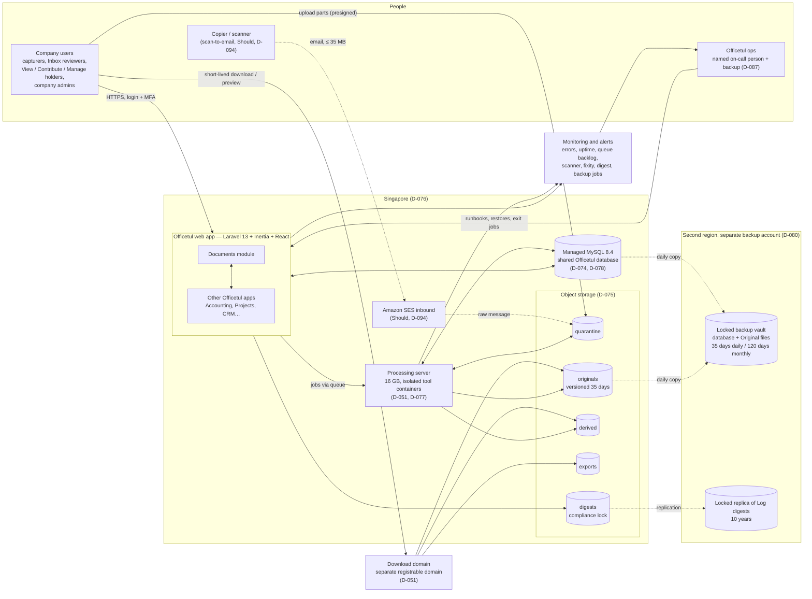
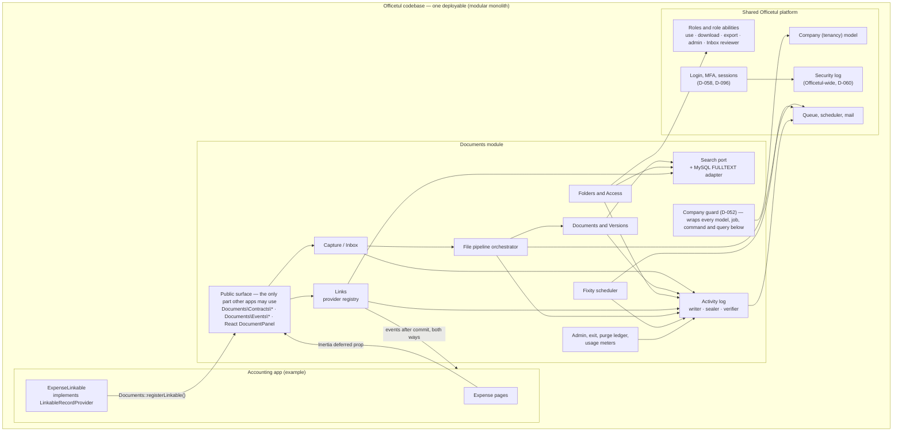
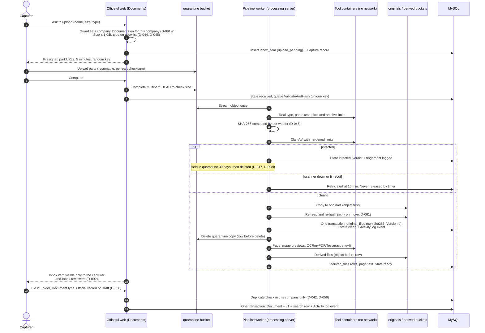
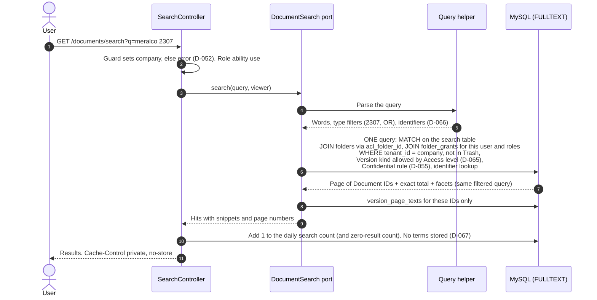
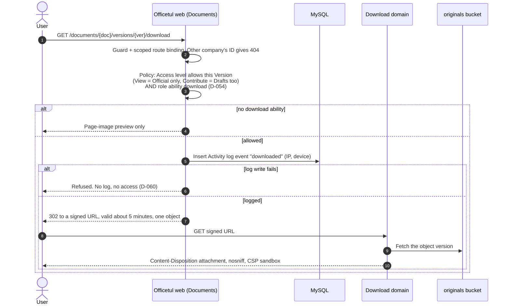
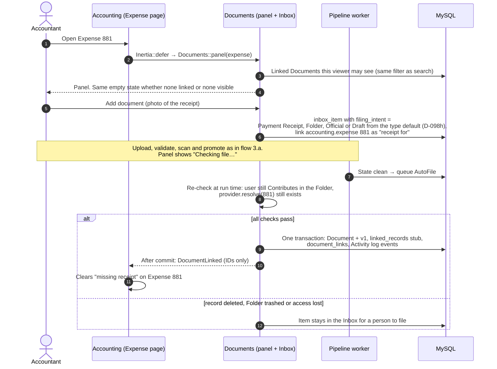
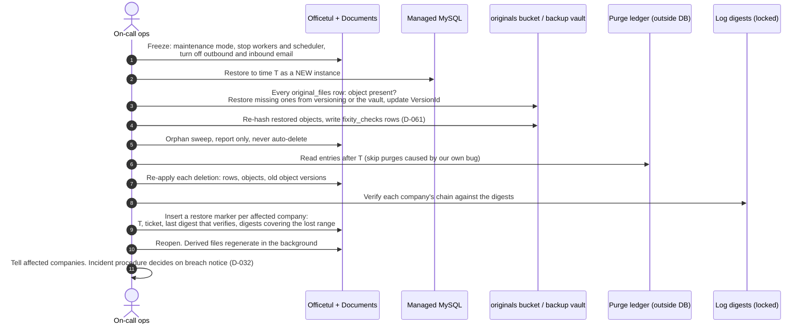
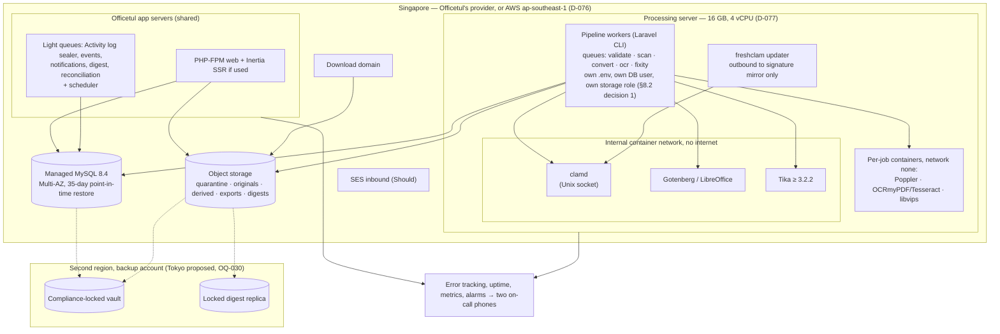

# R21 — Architecture proposal (Section 20)

- **Status:** First pass, design-level. Synthesis only, no code and no new outside research. Architecture of Officetul Documents as agreed in D-001 to D-098, for Master plan Phase 12.
- **Prepared:** 2026-10-21. Basis: [DECISION-LOG.md](../DECISION-LOG.md) (D-001 to D-098, with their amendments), [GLOSSARY.md](../GLOSSARY.md), Sections 06, 07, 09, 12–17, research notes R13–R20, and the [ERP technical questionnaire](../questionnaires/erp-technical-questionnaire.md) (Q1–Q33).
- **Question:** What are the parts of Officetul Documents, where does each run, how do the main flows work, and what must the Officetul code review confirm before building?
- **Labels:** **Verified fact** (stated in the decision log or an agreed section), **Estimate**, **Open question**, **Recommendation** (proposed, not approved). Decision IDs `D-0xx` point to the decision log. Section and note references (`S12 §6.1`, `R17 §4`) point to the source of each design detail.
- **ADRs:** six architecture decision records in [docs/adr/](../docs/adr/README.md).

**Limits.** The Officetul code has not been seen (D-013), so every statement about Officetul's own structure is an assumption until the code review. Officetul's hosting provider is unknown (Q12), so the diagrams show the AWS Singapore case. Under D-076 the same shapes apply on another S3-compatible provider. Table names follow Section 16 §6.1; names not fixed there are marked "name to confirm".

---

## 0. Summary

- **One modular monolith.** Documents is an app inside the Officetul codebase and database (D-002, D-007, D-010). Other apps may use only `Documents\Contracts\*`, `Documents\Events\*` and the React Documents panel (R17 §4.6). *(Verified fact for the native module; Recommendation for the namespace rule)*
- **Two pieces run outside the Officetul web servers:**
  - a dedicated **processing server** that reads untrusted files in isolated, network-less containers (D-051, D-077);
  - **object storage** in five classes: quarantine, originals, derived, exports and digests (D-075). *(Verified fact)*
- **Fail closed everywhere:**
  - no company known → error (D-052);
  - no clean scan → no Inbox item (D-047);
  - no log entry → no download (D-060);
  - no access → no hint in search (D-056). *(Verified fact)*
- **Integrity has three layers:**
  - a write-once Original file with SHA-256 (D-026, D-046, D-075);
  - a hash-chained Activity log with a daily Log digest in locked storage (D-061);
  - Fixity checks (D-061). *(Verified fact)*
- **Recovery has three layers:**
  - storage versioning for Original files, 35 days (D-073, D-098c);
  - point-in-time database restore (D-078, D-081);
  - locked backups in a second region, plus a purge ledger and restore marker so restores never bring back deleted data or rewrite history (D-080, D-084). *(Verified fact)*
- **Five decisions for the owner** (§8.2). They come from gaps found while drawing the architecture:
  - where the file-pipeline workers run;
  - where the purge ledger lives;
  - how exit deletion gets past the insert-only Activity log;
  - an off-database copy of the Security log;
  - how the download domain sets its security headers.

---

## 1. Context diagram

Who and what Documents talks to. Solid lines are MVP. Dotted lines are Should, later, or proposed in §8.2.

| Actor or system | Role | Label |
|---|---|---|
| Company users | Capture, file, search, view and download within their Access levels; company admins run settings and the Activity page | Verified fact (D-053, D-054, D-092) |
| Officetul ops | On-call duty, alerts, restores, ops-run export for the first client, exit jobs; no access to Documents content for the first client | Verified fact (D-087, D-090, D-095) |
| Other Officetul apps | Register linkable records and show the Documents panel | Verified fact (D-075) |
| Processing server | Hash, validate, scan, convert, preview and OCR | Verified fact (D-051, D-077) |
| Managed MySQL 8.4 | One shared database; Documents adds its own tables | Verified fact (D-074, D-078) |
| Object storage | Five storage classes with random-ID keys | Verified fact (D-075) |
| SES inbound | Scan-to-email after the first client; nothing is built for it in the MVP | Verified fact (D-094) |
| Backup account, second region | Locked vault (Tokyo proposed, OQ-030) and the replicated digests | Verified fact (D-080) |
| Monitoring | Shared Officetul tools plus new Documents checks | Recommendation (R18 §1.1) |

---

## 2. Container and component view

### 2.1 Diagram

### 2.2 What each component owns *(Verified fact for tables named in Section 16 §6.1; Recommendation for the split into components)*

| Component | Owns (tables / storage) | Does | Decisions |
|---|---|---|---|
| **Capture / Inbox** | `inbox_items` (state, `filing_intent`), `capture_records` | Upload signing, Inbox review, filing as Official record or Draft, duplicate warning, rejected-item clean-up after 30 days | D-015, D-036, D-042, D-092, D-094, D-098g |
| **Documents and Versions** | `documents`, `versions`, `original_files`, `derived_files`, `paper_originals`, `document_types`, `document_relations` (Should) | Version states, one Official version (generated column + unique index), write-once content (trigger backstop), Trash, permanent delete with reason category | D-035–D-043, D-070, D-071, D-075, D-082, D-098b |
| **Folders and Access** | `folders` (parent pointer + `acl_folder_id`, Restricted, Confidential, finance flag), `folder_grants` | Access levels View / Contribute / Manage, "Why can I see this?" and "Who can see this?" | D-053, D-055, D-093, D-098a, D-098f |
| **Links** | `linked_records` (one stub per Officetul record, "record deleted" flag), `document_links`, `link_types` ("Grants view" off and hidden in the MVP) | Provider registry, enforced morph map, Documents panel, events both ways, nightly consistency check, expenses report | D-019, D-023, D-069, D-072, D-075, D-093 |
| **Search port + MySQL adapter** | Search table (one row per searchable Version; name to confirm), `version_page_texts`, `document_identifiers`, daily search counters | `DocumentSearch::search(query, viewer)`; one filtered query for hits, totals and facets; snippets only for the returned page | D-056, D-064–D-068 |
| **File pipeline orchestrator** | File state per upload (`document_file_events`, R13 §4.1; name to confirm); the quarantine, originals and derived buckets | Validate → hash → scan → promote → previews / OCR; held, infected and encrypted cases | D-044–D-049, D-051, D-075 |
| **Activity log** | `activity_events`, `activity_payloads` (redactable), `activity_seals`; the digests bucket | Writes in the same transaction as the change; seals the per-company chain; daily Log digest; nightly verifier | D-060–D-063, D-084 |
| **Fixity scheduler** | `fixity_checks` (insert-only) | Checks on arrival and every move; 1/90 of each company's files each night, oldest-checked first; nightly random sample | D-061, D-081 |
| **Admin, exit, purge ledger** | Exports bucket; purge ledger (outside the database, §8.2 decision 2); usage meters | Ops-run full export, exit job and certificate, restore marker, storage and OCR-page meters (shown, not enforced) | D-033, D-083, D-084, D-090, D-095, D-097 |

### 2.3 The public surface *(Recommendation, R17 §4.6)*

| Other apps may use | Example | Rule |
|---|---|---|
| `Documents\Contracts\*` | `LinkableRecordProvider`, `RecordSummary`, `RecordVisibility`, the `Documents` facade (`registerLinkable`, `panel`, `recordsDeleted`) | The only Documents PHP namespace other apps may use |
| `Documents\Events\*` | `DocumentLinked`, `OfficialVersionChanged`, `VersionWithdrawn`, `DocumentTrashed`… | IDs only in payloads; dispatched after commit |
| React `<DocumentPanel>` | On Expense, Project and Customer pages | Same visibility function as search (D-056) |

Two Pest architecture tests enforce this:
- nothing outside Documents uses `Documents\*` except the public surface;
- Documents never queries another app's tables, except through a provider's query builders.

### 2.4 The company guard as a cross-cutting layer *(Verified fact D-052; detail Recommendation, R15 §1.3)*

- Every Documents model uses one trait (for example `BelongsToCompany`). Its scope **throws** when no company is set.
- On create, the trait fills `tenant_id` and refuses a value from user input.
- Jobs carry the company and **reset it after** each run.
- Scheduled commands loop company by company.
- Code that must cross companies (ops, exit, restore) uses one logged escape, `runAsSystem`.
- The database adds a backstop: `UNIQUE (tenant_id, id)` on parents, `(tenant_id, parent_id)` foreign keys on children, ULID keys (D-075).
- Another company's ID returns **404**.

---

## 3. Key flows

### 3.a Browser upload to filing *(D-046, D-047, D-051, D-075, D-092)*

**Notes:**
- A processing failure leaves the Original file downloadable without a preview (S12 §6.2).
- Password-protected files are held until a company admin accepts the risk (D-048).
- Duplicates are checked only inside one company. A duplicate in a Folder the uploader can't see is flagged to that Folder's Manage holders, never to the uploader (D-056).
- Rejected Inbox items are deleted after 30 days, and the deletion is logged (D-092).

### 3.b Search with the access filter inside the query *(D-056, D-064, D-065, D-066, D-067)*

**Notes:**
- No "Did you mean" suggestions (D-067).
- An empty result looks the same whether nothing matches or the matches are hidden (D-056, tested by D-068).
- In the MVP, Link visibility adds no access path (D-093).
- A later Meilisearch adapter fits behind the same port, fed by an outbox (R16 §5.2). The switch triggers are in D-064.

### 3.c Download: "no log, no access" and the separate download domain *(D-051, D-054, D-060)*

**Notes:**
- Previews follow the same path. Their log entries are grouped per user, per Version, per 10 minutes, and they are served `private, no-store`, keyed by Version, never by fingerprint (S12 B2).
- Encrypted files have no preview (D-048).
- Signed URLs are never logged (R15 leak path 13).
- How the download domain adds `nosniff` and CSP `sandbox` is decision 5 in §8.2.

### 3.d Attach from an Officetul record page *(D-036, D-075, D-098h)*

**Notes:**
- If Expense 881 is later deleted, its Link stays and is marked "record deleted" (D-069).
- The nightly consistency check catches bulk deletes that fire no event (R17 §4.2).
- The expenses report counts only an Official, non-Trash Document of the right type (D-072).

### 3.e Restore with purge-ledger replay and restore marker *(D-079, D-084, D-085)*

**Notes:**
- Lost Activity log entries are never rewritten or invented. The locked digests prove they existed (D-084).
- A restore for one company is done on a side instance, with an insert-if-absent copy-back through the guard. It is never an in-place rollback (R19 §5.1).
- Targets: everyday incident 5 minutes / 4 business hours; disaster 24 hours / 2 business days (D-079). The disaster target is published only once infrastructure as code exists (C-15, R20 §5).

---

## 4. Deployment view

| Where | What runs | Isolation and notes | Label |
|---|---|---|---|
| **Officetul app servers** (shared) | Web requests, upload signing, search, downloads (redirects only), Documents panel; light queues (sealer, events, notifications, digest, reconciliation) and the scheduler | File bytes never pass through PHP-FPM; the request body limit stays small (D-046, R13 §1.3) | Verified fact (D-046); placement Recommendation |
| **Processing server** (new, dedicated) | Pipeline workers plus tool containers: ClamAV, Gotenberg/LibreOffice, Tika, Poppler, OCRmyPDF/Tesseract, libvips | Each tool in its own container, unprivileged, read-only root, tmpfs scratch wiped per job, CPU/memory/time limits; **no network** for the tools; Gotenberg and Tika on an internal network with no route out (D-051, S12 §6.3) | Verified fact (D-051, D-077) |
| **freshclam** | Signature updates | The one tool container that needs outbound access, only to the ClamAV mirror. It writes signatures to a volume that clamd reads; clamd itself has no network. Alert when signatures are over 24 h old (S12 §6.2). | Recommendation (resolves "no network" for ClamAV) |
| **Managed MySQL 8.4** | All Officetul and Documents tables | At least three database users: web app, pipeline workers, migrations (D-061, D-096); a fourth "purge" user is proposed in §8.2 decision 3 | Verified fact (D-078, D-061) |
| **Object storage** | Five classes; keys hold random IDs only | Web role can't read quarantine; only the pipeline role can (R13 §4.1). Originals versioned 35 days, no Object Lock (D-073, D-098c). Digests compliance-locked 10 years (D-061, D-062). | Verified fact |
| **Backup account, second region** | AWS Backup daily copies of the database and Original files; locked digest replica | Own root user with hardware MFA held by two people; own encryption keys; no standing access from the main account (R19 §3.5). Not backed up: Derived files, quarantine, exports (D-080). Non-AWS hosting: XtraBackup + 5-minute binlogs + a locked copy of originals in AWS Singapore. | Verified fact (D-080); controls Recommendation |
| **SES inbound** | Scan-to-email | After the first client (D-094); writes to quarantine only | Verified fact |
| **Network** | TLS everywhere; the processing server has no public inbound ports; the database is reachable only from app servers and the processing server | | Recommendation (D-059 for TLS) |

**Sizing** *(Estimate, R18 §1.1, S14 §6.3):*
- the processing server needs about 8.5–10.5 GB of RAM at pilot and year 1, so 16 GB is the planning size;
- at growth it splits into an intake server and an 8-vCPU OCR server;
- the database grows by about 5–35 GB in year 1.

**Environments.** There is no separate pilot environment. Our own pilot runs on production, with Documents switched on for our company only (D-091).

---

## 5. Cross-cutting concerns

| Concern | Design | Decisions | Where enforced |
|---|---|---|---|
| **Company isolation** | Fail-closed guard; composite company keys; ULIDs; 404 for other companies' IDs; logged `runAsSystem` escape; each of the 21 leak paths (jobs, cache, search, storage links, Derived files, exports, logs, emails…) has a named control (R15 §2) | D-052, D-075 | Model trait, job middleware, database keys, architecture tests, two-company suite that **blocks release**; manual check before each pilot |
| **Authorisation** | Layer 1, role abilities: use, download, export, admin, Inbox reviewer. Layer 2, Folder grants: View, Contribute, Manage; Restricted and Confidential folders. **Folders alone grant access in the MVP**: Links grant nothing, and there are no per-Document permissions. Sensitivity is only a label. Permission is re-checked when a job runs. | D-053–D-055, D-092, D-093, D-098a | Policies on every lookup; the same visibility function for lists, search, panels and the log |
| **No hints** | Results, counts, facets, snippets, panels, previews and the Activity log come only from the viewer's permitted set; identical empty states | D-056, D-067, D-068 | Search port contract tests; "list equals detail" test |
| **Logging and integrity** | Activity log (company) and Security log (Officetul); written in the same transaction as the change; insert-only grants plus blocking triggers; per-company hash chain sealed asynchronously; daily Log digest under compliance lock; nightly verifier; redactable payload; no content and no search terms in either log | D-060–D-063, D-084 | Own log writer, `activity_seals`, digests bucket, verifier alerts |
| **File integrity** | SHA-256 by our worker; write-once Versions; Fixity checks on arrival, on every move, over a rolling 90 days, plus a nightly sample | D-046, D-061, D-075 | Pipeline, `fixity_checks`, alerts treated as incidents |
| **Security headers and download domain** | Forced download (`attachment`), `nosniff`, CSP `sandbox`, signed URLs of about 5 minutes on a separate registrable domain that shares no cookies; page-image previews only; `private, no-store` on authenticated responses | D-051, D-056 | Download controller; header delivery is §8.2 decision 5 |
| **Encryption** | Provider-key encryption for storage, database, backups and exports; TLS everywhere; no per-company keys in the MVP; backup copies use backup-account keys | D-059, D-080 | Provider settings; R19 §3.5 |
| **Secrets** | `APP_KEY` and other secrets backed up outside the servers, reachable by two people; pipeline workers get their own `.env` without web secrets; break-glass kit held by the senior partner | D-087, RK-63, Q32 | Runbook; secret store (to confirm in the code review) |
| **Authentication** | MFA (authenticator or passkey, no SMS) required for company admins and Officetul staff; 60 min idle / 12 h sessions; password re-entry for permanent delete, access changes, export | D-058, D-096 | Officetul platform work owned by the maintainer |
| **Staff access** | First client: no staff access to content; screen-share only; "log in as" disabled for Documents. Full Support access workflow before the second client. | D-057, D-095 | Route middleware; Security log |
| **Observability** | Error tracking and uptime (shared tools); alerts on queue backlog, scanner down at 15 min, signatures over 24 h old, held files, fixity or chain failure, digest upload failure, clock drift over 1 s, backup job failure, destructive cloud actions; app logs keep IDs only, 30 days | D-047, D-061–D-063, D-087; R18 §1.1, R19 §3.5 | Monitoring tools, alarms to two on-call phones |
| **Configuration flags** | Documents switched on per company (D-091); per-company options: require MFA for everyone, shorter idle time, `ceb` OCR, finance Folder flag, Link types; usage meters shown, not enforced (D-097); scan-to-email off until Should | D-049, D-058, D-091, D-097, D-098f | Company settings (mechanism to confirm in the code review) |
| **Idempotent jobs** | Unique job keys (`tenant_id:sha256:stage` or upload ID); job timeout below `retry_after`; at-least-once handlers; "object before row, row before delete" with a daily orphan sweep; after-commit dispatch; nightly link reconciliation | D-075; R13 §4.2, R17 §4.2 | Job base class, architecture tests |
| **Time** | UTC `DATETIME(6)` storage, Asia/Manila display, chain order rather than clock order | D-063 | chrony on every server, drift alert |
| **Data retention** | No automatic purge; Trash, then permanent delete by a company admin with a reason category; exit after 30 days of export; backups at most 120 days; digests 10 years | D-041, D-062, D-081–D-083, D-098c–e | Purge ledger (D-084) |

---

## 6. Architecture-significant decisions

"Hard to reverse" means changing it later needs a data migration, a re-key or rework across many components, not just new code.

| # | Decision | IDs | Hard to reverse? | Why | ADR |
|---|---|---|---|---|---|
| 1 | Documents is a native module in the Officetul codebase and database, with one public namespace | D-002, D-007, D-010, D-075 | **Yes** | Splitting it out later means a new auth, tenancy and link API | [0001](../docs/adr/0001-native-module-in-shared-database.md) |
| 2 | Fail-closed company guard plus composite company keys and ULIDs | D-052, D-075 | **Yes** | Keys and foreign keys are in every table | [0003](../docs/adr/0003-fail-closed-company-guard-and-composite-keys.md) |
| 3 | MySQL 8.4 for everything; FULLTEXT search behind a port | D-064, D-074, D-078 | Engine: **yes**. Search engine: no, by design (2–4 developer-weeks, Estimate) | The port keeps the switch cheap | [0002](../docs/adr/0002-mysql-fulltext-behind-search-port.md) |
| 4 | Hash-chained, insert-only Activity log with a locked daily digest | D-060–D-063 | **Yes** | Digests already written can't be changed; the chain format is fixed once sealed | [0004](../docs/adr/0004-hash-chained-activity-log-with-locked-digest.md) |
| 5 | Locked backups in a separate account and second region, with a purge ledger and restore marker | D-080, D-081, D-084 | **Yes** | Compliance locks can't be shortened; the region is named in the data processing addendum | [0005](../docs/adr/0005-locked-cross-region-backups-and-purge-ledger.md) |
| 6 | Folders alone grant access; no per-Document permissions | D-053, D-093, D-098a | Partly | Adding exceptions later touches the search query, panels and "Why can I see this?" | [0006](../docs/adr/0006-folders-only-access.md) |
| 7 | Direct-to-storage resumable uploads; SHA-256 by our worker | D-046 | Moderately | Needs multipart-capable object storage | — |
| 8 | Fail-closed scanning; isolated network-less tools on a dedicated server | D-047, D-051, D-077 | No (operational) | Infrastructure can change without data migration | — |
| 9 | Class-first buckets, random-ID keys, versioned originals without Object Lock, one stored copy per company per file | D-070, D-073, D-075 | **Yes** | Key layout and lifecycle rules live on stored objects | — |
| 10 | Write-once Versions; one Official version per Document enforced by the database | D-038, D-075 | **Yes** | Schema-level rule | — |
| 11 | Singapore hosting; no Philippine hosting in the MVP | D-076 | Moderately | Moving region means moving data and updating the addendum | — |
| 12 | `LinkableRecordProvider` contract and an enforced morph map | D-075, D-096 | **Yes** for the morph map | Stored type aliases across all Officetul apps | — |
| 13 | "No log, no access" and grouped view logging | D-060 | No | Policy in code | — |
| 14 | Provider-key encryption; no per-company keys | D-059, D-083 | Moderately | Per-company keys later mean re-encrypting stored files | — |

---

## 7. What the Officetul code review must confirm (D-013)

The questionnaire numbers (Q1–Q33) and R15 §13, R14 §10 and R17 §11 are merged here and de-duplicated. The review is held in the first two weeks of the build; estimates are redone right after it (RK-71).

### 7.1 Tenancy and isolation

| # | Check | Source | If different, what changes |
|---|---|---|---|
| T1 | How companies are separated: shared tables with a company column (name and ID type), database per company, or a package | Q1, Q27, R15 §13.1 | **Database per company:** the guard becomes a connection switch, search and backups become per database, and ADR-0003 is revisited. **Different column name or type:** rename `tenant_id`, and `linked_records.record_id` takes Officetul's ID type |
| T2 | What queries do when no company is set (job, command) | Q18 | **Unscoped:** the guard still protects Documents models, but the Officetul-wide fix goes to the maintainer (D-096, RK-43) |
| T3 | How a request finds its company (subdomain, session, user) | Q2 | **Subdomain:** cookie scope and download-domain choice must avoid sharing cookies; company switching becomes a domain change |
| T4 | Can one user belong to several companies, and how do they switch? | Q3, OQ-025 | **Yes:** session regenerated and roles cache cleared on switch (leak path 11); Inbox and grants are per company; test a two-company user |
| T5 | Unscoped queries, `withoutGlobalScopes`, `unique`/`exists` rules without the company | R15 §13.2–3 | **Many:** static bans apply to the Documents namespace only; findings go to the maintainer's list |
| T6 | Queue driver, how jobs learn their company, Octane or long-lived static state, `retry_after`, Supervisor or Horizon, scheduler running | Q11, Q24, R15 §13.5–6 | **No workers or scheduler:** they must be set up before Gate A (sealer, digest, fixity and reconciliation depend on them). **Octane:** add per-request reset tests |
| T7 | Caches in front of logged-in pages; cache key prefixes; `Cache::flush()` use | Q23, R15 §13.7 | **CDN caches logged-in pages:** bypass rules before Gate A; all Documents cache keys get a company prefix |
| T8 | IDs in URLs (numbers or random) and whether route bindings are company-scoped | Q22, R15 §13.4 | **Plain numbers:** Documents still uses ULIDs; the IDOR sweep must also cover Officetul record IDs inside Documents routes |
| T9 | Broadcasting channels and their authorisation | R15 §13.13 | **Used for live updates:** channels named per company and user, with a membership check |

### 7.2 Login, roles and staff access

| # | Check | Source | If different, what changes |
|---|---|---|---|
| A1 | Login package; 2FA or passkeys; password confirmation; session settings | Q7, R15 §13.8–9 | **No 2FA:** platform work grows toward the top of the 0.5–8 developer-week range (D-096) |
| A2 | Roles and permissions package, teams mode, client-defined roles, permission caching | Q8, R15 §13.10 | **No client-defined roles:** Folder grants go to users plus fixed roles. **Custom system:** the role abilities (use, download, export, admin, Inbox reviewer) are added to it, not a second system |
| A3 | How Officetul decides who may open a record (role, owner, branch) | Q19, OQ-025 | Decides when Link visibility (Should, D-093) can be built and how costly the provider's visibility subquery is |
| A4 | "Log in as" feature; staff querying production directly | Q20, R15 §13.17 | **Exists:** disabled for Documents before Gate B (D-095), and removed or wrapped by the Support access workflow (D-057) |

### 7.3 Database, data and logging

| # | Check | Source | If different, what changes |
|---|---|---|---|
| D1 | MySQL version or MariaDB; managed or self-managed; encryption at rest | Q4, Q21, OQ-028, R15 §13.20 | **RDS 8.0:** upgrade now (D-078). **MariaDB:** check the JSON and generated-column plan; may reopen D-074. **Self-managed:** backups follow the non-AWS path in D-080 |
| D2 | Database user the app uses; whether migrations use the same user | Q21 | **Admin user:** separate users are needed before the insert-only log is real (D-061, D-096); until then, no "tamper-evident" claim |
| D3 | Existing activity or audit log and what it records | Q9 | Documents keeps its own writer (D-063). The Security log is Officetul-wide (C-29), so its home is agreed with the maintainer |
| D4 | Existing FULLTEXT indexes; changed full-text settings, stopwords, charset or collation | Q25 | **Changed settings or a different collation:** redo the tokenisation tests (identifiers, Filipino words); never change server-wide settings for Documents alone (RK-49) |
| D5 | Global search bar; Scout and its engine | Q15, Q26 | **Global search exists:** Documents contributes results only through its search port, with the same filter; no Scout observers |
| D6 | Polymorphic columns that store class names; existing morph map | Q28 | **Class names stored:** a one-step morph-map migration by the maintainer before Gate A (D-096, RK-52) |
| D7 | How records are deleted: soft, hard, bulk, "void" | Q29 | Every bulk path must call `Documents::recordsDeleted`; "void" may count as a status change, not a delete; the nightly reconciliation stays either way |
| D8 | Expense (or Bill) model, table and fields | Q30 | **None:** the expenses report (D-023, D-072) waits for Accounting to provide `reportQuery()` |
| D9 | Existing file attachments on records, and where those files are | Q6, Q10 | **Exist:** keep them working; offer a later, logged import into Documents rather than silently moving them |
| D10 | ID column types of the company and of records | Q27 | `linked_records.record_id` and foreign-key types must match |

### 7.4 Code structure and front end

| # | Check | Source | If different, what changes |
|---|---|---|---|
| C1 | How apps are organised (nwidart, internachi/modular, plain folders); menu and service-provider registration | Q5 | Documents follows the same structure; the Pest architecture tests point at its namespace |
| C2 | PHP, Laravel, Inertia, React and Node versions | Q4, Q24 | **Inertia older than v2:** the panel fetches its own data instead of using a deferred prop. **PHP 8.3:** Pest 5 is unavailable; use Pest 4 |
| C3 | How an app is switched on per company | D-091 | **No mechanism:** add a company setting and check it in Documents routes, jobs and menus |
| C4 | Test suite, CI, staging, deployment | Q17, R15 §13.18 | **No CI:** the isolation suite can't block releases (D-052) until CI exists; this becomes Gate A work |
| C5 | Logging and error tracking: what is logged (bodies, URLs), company tagging, who reads logs | R15 §13.15 | **Bodies or URLs logged:** scrub them for Documents routes (no content, no signed URLs) |

### 7.5 Infrastructure and operations

| # | Check | Source | If different, what changes |
|---|---|---|---|
| I1 | Hosting provider, server sizes, managed by whom | Q12 | **Not AWS:** check compliance-mode Object Lock, version expiry and lifecycle rules; otherwise files, the processing server and inbound email go to AWS Singapore (D-076, RK-56) |
| I2 | One cloud account or several; who holds root, with MFA, on a company address | Q33 | **One account with a personal root login:** set up company-owned root plus the separate backup account before Gate B |
| I3 | Current backups and any restore ever tested | Q13 | D-080 replaces or extends them; the first drill before Gate B is also Officetul's first, if none exists |
| I4 | Infrastructure described in code | Q31 | **By hand:** the 2-day disaster target is not published until a full rebuild has been done (C-15) |
| I5 | `APP_KEY` and secrets backed up outside the servers; who can reach them | Q32 | **Not backed up:** fix before Gate A, because encrypted columns are unreadable without the key after a restore (RK-63) |
| I6 | Outbound and inbound email service | Q14 | Notifications use it; SES inbound is added only for scan-to-email (D-094) |
| I7 | Number of companies and users; largest company | Q16 | Re-checks the sizing in S14 §6.3 and the two-company test data |

---

## 8. Open technical questions and decisions for the owner

### 8.1 Open technical questions (answered by tests, the code review or the benchmark)

| # | Question | How it gets answered | Label |
|---|---|---|---|
| OT-1 | How long the pipeline takes to hash and scan a 1 GB file on a 4-vCPU server, and how much local scratch disk the worker needs (R18 budgets 40 GB) | Pipeline load test before Gate A | Open question |
| OT-2 | Job timeouts and `retry_after` for long OCR jobs (a 1 GB drawing set) without duplicate runs | Load test; per-queue settings | Open question |
| OT-3 | Grouped view logging on an insert-only table: one row per user, Version and 10-minute window, using a unique key and insert-if-absent | Prototype in the first sprint | Recommendation |
| OT-4 | The cut-off for the daily Log digest (Manila midnight or UTC) and the sealer's lag before an entry is chained | Technical default; document it in the verifier output | Open question |
| OT-5 | How MySQL 8.4 FULLTEXT splits `123-456-789-000`, `2550Q` and `OR#4521` on Officetul's collation | Test on the target version (S13 §14) | Open question |
| OT-6 | The OCR text cap per Version | From benchmark throughput (D-050, D-098k) | Open question |
| OT-7 | Whether the tool images run on ARM servers (about 24% cheaper if they do, RK-57) | Image check before choosing server types | Open question |
| OT-8 | Second backup region: Tokyo or Malaysia | Locked-vault support check (OQ-030) | Open question |
| OT-9 | Whether a non-AWS provider (if chosen) supports multipart upload, versioning, lifecycle rules and compliance lock | Provider check after Q12 | Open question |
| OT-10 | Table names not fixed in Section 16: the search table and the file-event table. R14 uses `document_activity` where Section 16 uses `activity_events`. | Fix in the data-model spec at handoff (Section 16 wins) | Recommendation |

### 8.2 Decisions for the owner

Five gaps or conflicts turned up while drawing the architecture. None changes an agreed decision; each fills a hole between them.

**1. Run the file-pipeline workers on the processing server, with their own database user and storage role?**
- **Recommended answer:** **Yes.** The pipeline workers (validate, scan, convert, OCR, fixity) run on the processing server, outside the tool containers. They get their own `.env` with no web secrets, a database user limited to the Documents pipeline tables, and the only storage role that can read quarantine. Officetul's app servers keep only light jobs.
- **Conflict it settles:** Section 14 §6.1 places "Web and queue workers" on Officetul's app servers. D-051 and R18 §1.1 say the worker pool is separate from web, and R13 §5.2 says it never uses web's `.env`.
- **Example:** a contractor uploads a 900 MB drawing set. Hashing and scanning it on the shared app servers would slow every Officetul page for everyone. On the processing server, only the file queue waits.
- **Cost:** none extra; the server is already budgeted (D-077).

**2. Give the purge ledger its own locked bucket, replicated to the backup account in the second region?**
- **Recommended answer:** **Yes.** The ledger lives in a sixth storage class ("ledger"), alongside the five in D-075. It holds IDs, times and reason codes only. It is locked for at least 120 days (the life of the oldest backup, D-081) and replicated to the backup account, like the Log digests.
- **Gap it closes:** D-084 says the ledger is "outside the database", and R19 §6.2 says "an append-only, versioned bucket". But D-075's bucket list doesn't include it, and D-080 replicates only the digests.
- **Example:** Singapore is lost and we rebuild in Tokyo from Monday's backup. On Tuesday, a client had permanently deleted a former employee's file for an erasure request. If the ledger lived only in Singapore, the Tokyo rebuild would bring the file back. With a replica, it is deleted again before anyone logs in.

**3. Use a separate "purge" database user for exit deletion and payload redaction, and let the blocking triggers allow only that user?**
- **Recommended answer:** **Yes.**
  - The web app keeps insert-and-read only on log tables (D-061).
  - Exit deletion (D-083) and erasure redaction of `activity_payloads` (D-061) run only as ops-run commands under the purge user.
  - The triggers block updates and deletes from every other user.
  - Each run is written to the purge ledger and the Security log.
- **Conflict it settles:** D-061 says the app's database user may only insert and read log rows, and the triggers block deletes. D-083 needs the whole Activity log of an exited company deleted (R19 §6.2), and D-061 needs payloads redactable.
- **Example:** a client leaves; on day 35 the exit job must delete about 2 million Activity log rows for that company. The web app's user can't, and today's triggers would stop anyone. The purge user can, and the deletion is recorded.

**4. Copy the Security log off the database in near real time?**
- **Recommended answer:** **Yes.** Every Security log entry is also sent within a minute to an append-only, versioned bucket, kept for 2 years (D-062). The Officetul maintainer owns it, because the Security log is Officetul-wide (C-29, D-096).
- **Gap it closes:** R19 §3.5 and §10 item 10 recommend this, but no decision adopted it.
- **Example:** an attacker logs in with a stolen admin password at 09:30 and deletes data. At 10:00 we restore the database to 09:00. Without an outside copy, the restore also erases the record of the 09:30 login we need for the breach report (D-032).

**5. Serve downloads and previews through a CDN on our own separate domain, so it can add the security headers?**
- **Recommended answer:** **Yes.** Use a CDN distribution (CloudFront on AWS) on a separate registrable domain (for example `officetul-files.com`), with:
  - 5-minute signed URLs;
  - caching off;
  - a response-headers policy adding `X-Content-Type-Options: nosniff` and `Content-Security-Policy: sandbox`.
- **Why a CDN:** plain storage signed URLs can set `Content-Disposition` and `Content-Type`, but not, as far as we know, these two headers (**Estimate**, to verify).
- **Example:** a user downloads a `.txt` file that actually holds HTML and JavaScript. `nosniff` and `sandbox` stop the browser from running it, even if someone opens the file link directly.
- **Cost:** small (**Estimate**), and the domain costs about a year's registration fee.

---

## 9. Dependencies and next steps

- **Depends on:** D-001 to D-098; senior partner approval of scope (D-089); the questionnaire and code review (D-013).
- **Feeds:** Section 19 (risk register: add risks for decisions 1–5 if declined), Section 21 (roadmap: E6 and E9 placement), Phase 13 handoff (data-model spec, tickets, test plan).
- [ ] Owner answers §8.2 decisions 1–5.
- [ ] Code review (§7) in the first two weeks of the build; update §2, §4 and the ADRs with the findings.
- [ ] Point the decision log's ADR pointer (line 5, `appendices/architecture-decisions.md`) to `docs/adr/`.

## 10. Sources

Internal only, read 2026-10-21:
- DECISION-LOG.md (D-001 to D-098);
- GLOSSARY.md;
- Sections 06, 07, 09, 12, 13, 14, 15, 16 and 17;
- research notes R13 (§1, §4–§6, §9), R14 (§2, §3, §10), R15 (§1–§2, §13), R16 (§4–§5), R17 (§4–§6, §11), R18 (§1), R19 (§3.5, §4, §6, §10) and R20 (§3);
- questionnaires/erp-technical-questionnaire.md.

No outside sources were consulted for this note. The one outside-fact claim (storage signed-URL header limits, §8.2 decision 5) is labelled **Estimate**.
