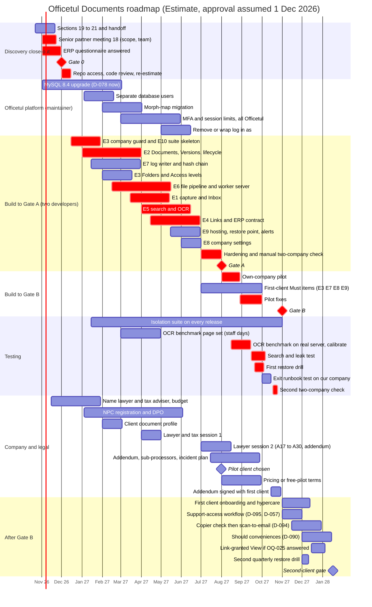

# R22 — Risk register and implementation roadmap

- **Status:** First pass for Phase 12 (Section 19, risk register; Section 21, implementation roadmap). Synthesis only: no code, no new market or legal research.
- **Prepared:** 2026-10-21.
- **Question:** Which risks threaten Officetul Documents, how big is each, and who watches it? In what order, and by when, does each piece of work have to happen between scope approval (Gate 0) and the second external client?
- **Inputs:** [DECISION-LOG.md](../DECISION-LOG.md) (D-001 to D-098, the source of truth, including the amendments in its last column), [OPEN-QUESTIONS.md](../OPEN-QUESTIONS.md), [DISCUSSION-TRACKER.md](../DISCUSSION-TRACKER.md), [MASTER-PLAN.md](../MASTER-PLAN.md), [PROJECT-CONTEXT.md](../PROJECT-CONTEXT.md), [GLOSSARY.md](../GLOSSARY.md), the "Risks and Limitations" table in every file in `sections/` (01–07, 09–18), [R20](R20-mvp-scope-synthesis.md) (§1 inventory, §3 consistency check, §4 effort, §5 gates, §6 risks), the three [questionnaires](../questionnaires/) and the six [meeting guides](../meeting-guides/).
- **Labels:** **Verified fact** (stated in the decision log or an agreed section), **Estimate**, **Open question**, **Recommendation** (proposed, not approved). Decision IDs `D-0xx`, open-question IDs `OQ-0xx`, lawyer questions `A#`, tax questions `B#` and ERP questionnaire questions `Q#` are the citations. No external source was consulted.

**Terms** follow [GLOSSARY.md](../GLOSSARY.md). Gate names follow [Section 17 §6.4](../sections/17-mvp-scope-and-prioritisation.md): **Gate 0** (before the build), **Gate A** (own-company pilot), **Gate B** (first external client). Epics E1–E10 are those of Section 17 §6.1. "Month 3" (M3) means the third month after the senior partner approves the scope.

---

## 0. Summary

- **The register holds 85 risks.** 72 IDs come from the sections (RK-01 to RK-72) and 13 are new (RK-73 to RK-85, §4). **46 are Open, 17 Mitigated by design, 9 Accepted and 13 Closed** (closed, superseded or merged; §5). *(Count from §2; statuses are a Recommendation until the owner accepts them, Q4)*
- **Register housekeeping** (§6, **Verified fact**):
  - no number is missing from RK-01 to RK-72, but RK-04 and RK-06 exist only as a "closed" sentence in Section 01;
  - seven IDs appear in two places with the same meaning (RK-03, RK-14, RK-25, RK-68 to RK-71);
  - two pairs are the same risk under different IDs (RK-09/RK-16, RK-12/RK-64);
  - two mitigations named in Section 05 (a "no official version" list for RK-27, an admin bulk purge for RK-29) are in no epic.
- **Top 5** (§3): designing blind against unseen Officetul code (RK-07); a cross-company leak (RK-42); weak demand (RK-01); a silent timeline slip (RK-68); senior partner approval delay (RK-74).
- **Roadmap** *(Estimate; two developers, D-089)*:

  | Gate | When |
  |---|---|
  | Gate 0 | M0 |
  | Design confirmed (code review done) | M1, week 2 |
  | Walking skeleton | end of M4 |
  | **Gate A** | end of M8 (range M7–M10) |
  | Own pilot ends | M9 |
  | **Gate B** | end of M11 (range M10–M14) |
  | **Second-client gate** | about M14 |

  If approval lands on 1 December 2026, Gate A is about August 2027, Gate B about November 2027 and the second client about mid-January 2028.
- **Critical path** (§10): approval → questionnaire and repository access → code review → company guard and Document model → file pipeline → capture → search and OCR → links → hardening and isolation checks → Gate A → own pilot → OCR benchmark, search test and first restore drill → Gate B.
  - The company and legal track (lawyer, NPC registration, data processing addendum) runs alongside. It becomes critical if it doesn't start by M2–M3.
- **Six decisions for the owner** are in §14. Each has a recommended answer worded so that "yes" accepts it.

---

# Part A — Risk register

## 1. How to read the register

| Column | Meaning |
|---|---|
| **L / I** | Likelihood and impact: **L** (low), **M** (medium), **H** (high). **Estimate** for every row, including the rows whose source section gave a figure. |
| **Score** | L × I, with L = 1, M = 2 and H = 3. **6–9** = high, **3–4** = medium, **1–2** = low. |
| **Mitigation** | What the decisions already do about it, with decision IDs. |
| **Owner** | The role that watches the trigger and acts. Roles: Owner, Senior partner, Officetul maintainer, Lawyer, Tax adviser, Developers, Ops on-call. |
| **Status** | **Open** (still live), **Mitigated by design** (the decisions remove most of it; residual risk watched), **Accepted** (a decision chose to live with it), **Closed** (gone, superseded or merged). |
| **Trigger** | The sign that the risk is turning real. Thresholds in triggers are a **Recommendation** unless a decision sets them. |

Categories: **Product/adoption**, **Security & privacy**, **Legal & compliance**, **Technical/integration**, **Delivery/schedule**, **Operations**, **Commercial**.

## 2. Register

**Verified fact:** the risk text, source and the decisions cited. **Estimate:** L, I and score. **Recommendation:** owner, status and trigger.

| ID | Risk | Category | Source | L | I | Score | Current mitigation | Owner | Status | Trigger to watch |
|---|---|---|---|---|---|---|---|---|---|---|
| RK-01 | **Weak demand:** clients don't adopt or pay for Documents | Product/adoption | 01 | M | H | 6 | Own pilot, then one client (D-017); the pilot is the validation (D-012); pilot measures (R20 10.4) | Senior partner | Open | Under half of our own staff use it weekly in the pilot; the first client declines paid terms |
| RK-02 | **Incumbent good enough:** clients stay on Drive or chat apps | Product/adoption | 01 | M | M | 4 | Lead with Links to Officetul records (D-019) and the expenses report (D-023, D-072) | Senior partner | Open | Pilot users still send scans by Viber or Drive; few Links created |
| RK-03 | **ISO over-claiming** ("ISO-certified software") | Legal & compliance | 01, 04 | L | M | 2 | Default claims rule (D-028); claims policy (D-029) | Senior partner | Mitigated by design | Any sales material says "ISO certified" |
| RK-04 | Market too thin | Commercial | 01 | — | — | — | Closed by D-002, D-003 | — | Closed | — |
| RK-05 | **Source quality:** some figures come from search excerpts | Commercial | 01 | H | L | 3 | Labels on every figure; re-check before external use | Owner | Open | A figure goes into a price sheet or client deck unchecked |
| RK-06 | No ERP channel information | Commercial | 01 | — | — | — | Closed by D-002, D-003 | — | Closed | — |
| RK-07 | **Designing blind:** the design clashes with Officetul's tenancy, roles, storage or queues | Technical/integration | 01 | H | H | **9** | ERP questionnaire and code review before build (D-013); narrow provider contract (D-075); guard inside Documents (D-052) | Owner | Open | Questionnaire Q1–Q3, Q18 show no company column or unscoped jobs; code review changes more than two defaults |
| RK-08 | **No pre-pilot validation:** wrong document assumptions surface late | Product/adoption | 01 | M | M | 4 | Client document profile (D-012); own pilot first (D-017) | Owner | Accepted (D-004, D-009) | Own pilot finds missing Document types or a missing workflow |
| RK-09 | **Clients destroy Paper originals** after scanning (merges RK-16) | Legal & compliance | 01, 03 | M | H | 6 | Never advise it (D-008); Paper original field on every type (D-026); claims policy (D-029); lawyer A2, tax B1 | Lawyer | Open | A client asks "can we throw the paper away now?"; tax adviser says scans can't replace 2307s |
| RK-10 | Scan-to-email abuse | Security & privacy | 01 | — | — | — | Channel moved to Should (D-094); approved senders, scanning and Inbox when built (D-015, D-047) | Developers | Closed (for the MVP) | Reopens when scan-to-email is scheduled |
| RK-11 | Scanners can't send email after Microsoft 365 / Google drop password-only device mail | Technical/integration | 01 | — | — | — | Superseded by D-094: no own mail service; upload and phone capture | — | Closed | Reopens with the OQ-019 copier check |
| RK-12 | Including Documents loses revenue | Commercial | 02 | — | — | — | Merged into RK-64 (same risk, more specific) | — | Closed (merged) | — |
| RK-13 | Opt-in link visibility exposes sensitive Documents | Security & privacy | 02 | — | — | — | Folders alone grant access in the MVP (D-093) | — | Closed (for the MVP) | Reopens when link-granted View is scheduled (OQ-025 answered) |
| RK-14 | **OCR quality too low** on poor scans, phone photos, receipts | Technical/integration | 02, 07 | M | H | 6 | Benchmark before Gate B (D-050); PaddleOCR then opt-in Azure fallbacks (D-049). Weakened: the low-OCR flag moved to Should (D-090) | Developers | Open | Benchmark keyword-hit rate below the owner's bar on receipts or phone photos |
| RK-15 | **Presets built on outdated rules** (OR change, PCAB cycle) | Legal & compliance | 03 | M | M | 4 | Labelled sources; presets are editable data (D-024); tax B1–B5, OQ-021 | Tax adviser | Open | A new BIR regulation on invoices; the tax adviser contradicts a preset |
| RK-16 | Clients scan and discard originals | Legal & compliance | 03 | — | — | — | Merged into RK-09 (same risk) | — | Closed (merged) | — |
| RK-17 | **Industry clients find the MVP too generic** | Product/adoption | 03 | M | M | 4 | Common fields now; packs later (D-025); accounting pack Could (D-090) | Owner | Accepted (D-025) | A law or construction firm is proposed as first client |
| RK-18 | **A deal needs ISO 27001** before we're ready | Commercial | 04 | L | M | 2 | ISO-ready controls (D-011); senior partner owns the goal (D-028) | Senior partner | Accepted (D-028) | A client or tender asks for a certificate |
| RK-19 | ISO effort competes with the MVP build | Delivery/schedule | 04 | — | — | — | ISO is a future goal, not blocking (D-028) | — | Closed (for the MVP) | Reopens if an ISO programme starts during the build |
| RK-20 | **Over-claiming legal effect** in sales or the UI | Legal & compliance | 10 | M | H | 6 | Claims policy and safe wording (D-029); lawyer A4 before launch | Senior partner | Open | Website or sales copy drafted before the lawyer review |
| RK-21 | A client presents an attested copy as a government CTC | Legal & compliance | 10 | — | — | — | No "Certified True Copy" feature (D-030) | — | Closed (for the MVP) | Reopens with "Copy issued from [Company] records" |
| RK-22 | **Processing alters signed PDFs** | Technical/integration | 10 | L | H | 3 | Write-once Original files (D-026, D-075); text sidecar only (D-031, D-049); PDF/A copy moved to Should (D-090) | Developers | Mitigated by design | A test shows a signed PDF's hash changing; PDF/A work starts |
| RK-23 | **Company not NPC-registered, no DPO** at launch | Legal & compliance | 11 | M | H | 6 | Pre-launch tasks are a Gate B item (D-032) | Senior partner | Open (OQ-024) | OQ-024 still unanswered at M3; NPC processing time unknown |
| RK-24 | **Slow breach notice** makes a client miss the NPC 72 hours | Security & privacy | 11 | L | H | 3 | 24-hour notice in the addendum (D-032); named on-call and backup (D-087); logs (D-060) | Ops on-call | Open | Incident procedure not written, or no tabletop exercise, by M10 |
| RK-25 | **Exit data lingers in backups** | Legal & compliance | 11, 15 | M | M | 4 | 120-day cap (D-081); certificate with expiry date (D-083); purge ledger (D-084) | Lawyer | Mitigated by design | Lawyer (A23, A27) says copies must go sooner |
| RK-26 | **Law firms' duties** (CPRA s.27–28) conflict with cloud hosting | Legal & compliance | 11 | M | M | 4 | Lawyer A13; law-firm rider; law pack later (D-025) | Lawyer | Open | A law firm is proposed as first client |
| RK-27 | **Staff skip marking official**, Documents sit as Draft | Product/adoption | 05 | M | M | 4 | Filing default per type (D-036); coverage needs an Official version (D-072). Gap: the "no official version" list is in no epic (§6) | Owner | Mitigated by design | In the own pilot, over 20% of record-type Documents still Draft after a week |
| RK-28 | **Wrong person marks official** | Product/adoption | 05 | L | M | 2 | Manage only (D-037); logged; withdraw and restore (D-038); approval chains next release | Owner | Mitigated by design | Pilot finds wrongly marked Official versions |
| RK-29 | **Trash grows forever** | Operations | 05 | M | L | 2 | No automatic purge by choice (D-041); meters shown (D-097); retention next release. Gap: bulk purge is in no epic (§6) | Owner | Accepted (D-041) | Trash above 10% of a company's storage |
| RK-30 | **Converter vulnerabilities** (LibreOffice, Poppler, image libraries) | Security & privacy | 06 | M | H | 6 | One container per tool, no network, limits (D-051); patch routine (D-087) | Ops on-call | Mitigated by design | A critical CVE in a pipeline tool not patched within the routine |
| RK-31 | **Users need previews of store-only formats** (CAD, ZIP) | Product/adoption | 06 | M | L | 2 | Ask for the PDF plot (D-044) | Owner | Accepted (D-044) | Pilot users keep downloading store-only files to view them |
| RK-32 | Local hosting lacks multipart storage | Technical/integration | 06 | — | — | — | Singapore hosting with S3-compatible storage; no PH hosting (D-076) | — | Closed | — |
| RK-33 | **OCR backlog** after bulk scanning | Operations | 07 | M | M | 4 | Separate queue and progress status; dedicated 16 GB server (D-077); back-file scanning quoted as a project (D-086) | Ops on-call | Mitigated by design | OCR queue wait above a day |
| RK-34 | Cloud OCR fallback leaks data | Security & privacy | 07 | — | — | — | No cloud OCR in the MVP (D-049) | — | Closed (for the MVP) | Reopens if the benchmark forces Azure Read |
| RK-35 | **Malware that antivirus misses** reaches a user | Security & privacy | 12 | M | M | 4 | Fail-closed pipeline (D-047); isolation, page-image previews, forced downloads from a separate domain (D-051) | Developers | Mitigated by design | A user reports a harmful download |
| RK-36 | **Held files pile up** when the scanner fails unnoticed | Operations | 12 | M | M | 4 | Alert at 15 minutes; status shown (D-047, D-087) | Ops on-call | Mitigated by design | Held queue not empty for 15 minutes |
| RK-37 | **Admin accepts a malicious encrypted file** | Security & privacy | 12 | L | M | 2 | Warning, logged acceptance, never previewed (D-048) | Owner | Accepted (D-048) | — |
| RK-38 | Hosting lacks Object Lock | Technical/integration | 09 | — | — | — | AWS Singapore Object Lock; replicated to the backup account (D-076, D-080; OQ-026) | — | Closed | — |
| RK-39 | **The app connects to MySQL as an admin user**, so insert-only log grants can't be enforced | Security & privacy | 09 | M | H | 6 | Separate database users as platform work (D-061, D-096); trigger backstop | Officetul maintainer | Open | Q21 answer: the app uses an admin or root user |
| RK-40 | **Log volume** grows faster than estimated | Operations | 09 | M | L | 2 | Views grouped per 10 minutes (D-060); measured in the own pilot | Developers | Open | Log rows per company well above the pilot estimate |
| RK-41 | **Over-claiming the log's legal weight** | Legal & compliance | 09 | M | M | 4 | "Tamper-evident" only once chain and digest run (D-061); D-029; lawyer A4, A19 | Senior partner | Open | "Tamper-evident" used before Gate B |
| RK-42 | **Cross-company leak** through a path the tests miss | Security & privacy | 12 | M | H | 6 | Fail-closed guard; isolation suite blocks releases; manual checks (D-052, D-091); no hints (D-056); 24-hour notice (D-032) | Developers | Open | Any isolation-test failure; any alert on a cross-company ID |
| RK-43 | **Officetul's tenancy can't fail closed** without changes outside Documents | Technical/integration | 12 | M | H | 6 | Code review first (D-013); guard in the Documents models only (D-052) | Owner | Open | Q1, Q18 answers: jobs and commands run without a company |
| RK-44 | Confidential folders orphaned | Operations | 12 | L | L | 1 | Admin can add themselves, logged and announced (D-055) | Owner | Mitigated by design | — |
| RK-45 | **Support access bypassed** by "log in as" or direct database access | Security & privacy | 12 | M | H | 6 | Remove or wrap "log in as" (D-057, D-096); interim policy for client 1 (D-095); database audit plugin next release | Officetul maintainer | Open | Q20 answer: impersonation exists or staff query production |
| RK-46 | Link visibility surprises a client | Security & privacy | 12 | — | — | — | Folders alone grant access in the MVP (D-093) | — | Closed (for the MVP) | Reopens with RK-13 |
| RK-47 | **MySQL full-text slow** at scale | Technical/integration | 13 | L | M | 2 | Swappable search interface and switch triggers (D-064); load test before 1M Documents | Developers | Mitigated by design | p95 search time above 1.5 s for two weeks (D-064) |
| RK-48 | **Users expect typo tolerance** | Product/adoption | 13 | M | M | 4 | Zero-result counts (D-067); switch trigger (D-064). Weakened: Taglish synonyms moved to Should (D-090) | Owner | Open | Zero-result searches above 10% (D-064) |
| RK-49 | **A server-wide full-text setting change** rebuilds other apps' indexes | Technical/integration | 13 | L | M | 2 | Identifier table instead of global settings (D-066); Q25 | Developers | Open | Q25 shows existing full-text indexes or changed settings |
| RK-50 | **The MySQL upgrade is larger** than expected | Technical/integration | 13 | M | M | 4 | Upgrade now (D-078); owned by the maintainer (D-096) | Officetul maintainer | Open | OQ-028 answer: MariaDB, or an estimate above 4 weeks |
| RK-51 | **Officetul's key types or module layout** differ | Technical/integration | 16 | M | M | 4 | Code review (D-013); Q25–Q30 | Owner | Open | Q22, Q27: integer company IDs and no module structure |
| RK-52 | **The morph map** affects every app storing class names | Technical/integration | 16 | M | M | 4 | One planned migration by the maintainer (D-096) | Officetul maintainer | Open | Q28: class names stored in existing columns |
| RK-53 | **Mass deletes in other apps** leave Links unflagged | Technical/integration | 16 | M | L | 2 | Nightly consistency check (D-075); "record deleted" rule (D-069) | Developers | Mitigated by design | Nightly check finds unexplained gaps |
| RK-54 | **"Permanently deleted" file still exists** (shared stored copy) | Legal & compliance | 16 | L | M | 2 | Sharing only within one company (D-070); certified deletion next release reports it | Owner | Accepted (D-070) | An erasure request hits a shared copy |
| RK-55 | **Link labels name people** and outlive erasure | Legal & compliance | 16 | L | M | 2 | Lawyer OQ-029; blank the label on erasure | Lawyer | Open | First data-subject erasure request |
| RK-56 | **Documents spans two providers** | Operations | 14 | M | L | 2 | Files and processing on AWS; one addendum lists both (D-076) | Owner | Mitigated by design | Q12 answer: provider without the storage features |
| RK-57 | **Container images don't run on ARM** (about 24% more cost) | Technical/integration | 14 | L | L | 1 | Check before choosing server types | Developers | Open | A tool image fails on ARM |
| RK-58 | **A client or the lawyer requires Philippine hosting** | Legal & compliance | 14 | L | M | 2 | Revisit D-076; Alibaba or Huawei Manila to research | Lawyer | Accepted (D-076) | Lawyer A12 or a client contract requires it |
| RK-59 | **OCR slower** than the laptop estimate | Technical/integration | 14 | M | M | 4 | Benchmark on the real server class (D-050); OCR server at growth (D-077) | Developers | Open | Benchmark pages per minute below the cost model |
| RK-60 | **A restore brings back erased data** | Legal & compliance | 15 | L | H | 3 | Purge ledger replayed before anyone logs in (D-084) | Ops on-call | Mitigated by design | A drill shows ledger replay failing |
| RK-61 | **Backups silently stop** | Operations | 15 | L | H | 3 | Daily health check; monthly automatic restore (D-085) | Ops on-call | Mitigated by design | A missed daily check |
| RK-62 | **No infrastructure as code**, so a region rebuild takes far longer than 2 days | Operations | 15 | H | M | 6 | Q31; infrastructure as code is Should (R20 9.12); disaster target published only after a rebuild (R20 C-15) | Developers | Open | Q31 answer: set up by hand |
| RK-63 | **Lost `APP_KEY`** makes encrypted columns unreadable | Operations | 15 | L | H | 3 | Secrets backed up outside the server (Q32); break-glass kit with the senior partner (D-087) | Officetul maintainer | Open | Q32 answer: secrets only on the server |
| RK-64 | **Prices below the fixed floor** (merges RK-12) | Commercial | 18 | M | M | 4 | Break-even figures to the senior partner (D-088, meeting guide 18) | Senior partner | Open | Price set below about ₱1,500 a company with fewer than 16 companies expected |
| RK-65 | **Storage tail:** no automatic purge, costs grow forever | Commercial | 18 | M | M | 4 | Meters shown per company (D-086, D-097); quotas wait for pricing | Senior partner | Open | A company passes the planned allowance before quotas exist |
| RK-66 | **Cost estimates wrong** (OCR speed, ARM, VAT credit) | Commercial | 18 | M | M | 4 | Re-run the model after the pilot and the benchmark | Owner | Open | Benchmark or pilot hours differ from the model by over 25% |
| RK-67 | **Ops time underestimated** | Operations | 18 | M | M | 4 | 12–16 hours a month budget; track actual hours (D-087) | Ops on-call | Open | Over 16 ops hours a month for two months |
| RK-68 | **Timeline slips silently** | Delivery/schedule | 17, R20 | H | M | 6 | Re-baselined (D-089); weekly own-pilot burn-down | Owner | Open | Burn-down two weeks behind; meeting guide 01 still says "4–6 months" (§6) |
| RK-69 | **Officetul platform work lands on the Documents developers** | Delivery/schedule | 17, R20 | M | M | 4 | Owned and estimated by the maintainer (D-096) | Officetul maintainer | Mitigated by design | No maintainer estimate by M1; a platform item late for its blocking month (§10.2) |
| RK-70 | A confidential scan seen in a shared Inbox | Security & privacy | 17, R20 | L | M | 2 | Inbox visibility (D-092) | Developers | Mitigated by design | — |
| RK-71 | **The code review invalidates estimates** late | Delivery/schedule | 17, R20 | H | M | 6 | Review in the first two weeks; re-estimate right after | Owner | Open | Re-estimate above the plan by over 10% |
| RK-72 | **Senior partner can't fund two developers** | Delivery/schedule | 17 | M | H | 6 | One-developer fallback (§12) | Senior partner | Open | Meeting guide 18 Q6 answered "one developer" |
| RK-73 | **Key-person dependency on the project owner** (§4) | Delivery/schedule | New | M | H | 6 | Repository trackers; runbooks (D-087) | Senior partner | Open | Owner away over two weeks; decisions waiting |
| RK-74 | **Senior partner approval delay** (§4) | Delivery/schedule | New | H | M | 6 | Meeting guide 18 ready | Senior partner | Open | Meeting 18 not held by mid-November 2026 |
| RK-75 | **ERP questionnaire or repository access late** (§4) | Technical/integration | New | M | H | 6 | Gate 0 item (D-013) | Officetul maintainer | Open | Questionnaire unanswered at M0; no repository access in week 1 |
| RK-76 | **Developers not available full-time** (§4) | Delivery/schedule | New | M | H | 6 | R20 §4.1 assumption 1 | Senior partner | Open | Developers not named at M0; over 20% of a month on Officetul support |
| RK-77 | **AI-assisted code weakens security-critical parts** (§4) | Technical/integration | New | M | H | 6 | Isolation suite blocks releases (D-052); architecture tests (D-075) | Developers | Open | The suite or review catches generated code bypassing the guard or search interface |
| RK-78 | **Holiday and tax seasons** cut capacity or client availability (§4) | Delivery/schedule | New | H | L | 3 | 80% productive week assumed (R20 §4.1) | Owner | Open | A gate or onboarding falls between 15 Dec and 6 Jan, in Holy Week, or (for an accounting client) Jan–15 Apr |
| RK-79 | **Staff don't change habits** at a pilot site (§4) | Product/adoption | New | M | M | 4 | Filing defaults (D-036); Inbox reviewer role (D-092); pilot measures | Owner | Open | Over 30% of Inbox items older than 7 days |
| RK-80 | **Lawyer and tax adviser not engaged in time** (§4) | Legal & compliance | New | H | M | 6 | Question list ready (D-034); Gate B allows recorded accepted risks | Senior partner | Open | Nobody named by M2 |
| RK-81 | **Officetul-wide changes disrupt existing clients** (§4) | Operations | New | M | M | 4 | Maintainer plans them (D-096) | Officetul maintainer | Open | Support tickets rise after MFA, session or upgrade rollout |
| RK-82 | **Sales outrun readiness** (§4) | Commercial | New | M | H | 6 | Gates (Section 17 §6.4); claims policy (D-029); D-095 | Senior partner | Open | A client is promised a start date before its gate is met |
| RK-83 | **Pilot feedback pulls Should items** in before Gate B (§4) | Delivery/schedule | New | M | M | 4 | Should list with "pilot shows one is essential" (D-090) | Owner | Open | More than one Should item promoted before Gate B |
| RK-84 | **Cloud owner account** held by one person or without MFA (§4) | Security & privacy | New | L | H | 3 | Separate backup account with locked vault (D-080); MFA for staff (D-058) | Officetul maintainer | Open | Q33 answer: personal email or no MFA on the root login |
| RK-85 | **No break-glass for the first client** (§4) | Operations | New | L | M | 2 | Accepted trade-off of D-095 | Owner | Accepted (D-095) | An incident with the client's admin unreachable |

## 3. Top 10

Ranked by score, then by impact, then by how soon the risk can bite. **Estimate** for every ranking.

| # | ID | In plain language | Why this L and I |
|---|---|---|---|
| 1 | RK-07 | **We designed Documents without seeing Officetul's code.** If Officetul stores companies differently from what we assumed, the company guard, keys and links need rework. | **H/H.** Repository access comes only after approval (PROJECT-CONTEXT), so a mismatch is likely. Tenancy touches every table. |
| 2 | RK-42 | **One company sees another's files.** This is the worst event for a document app: client trust, a 72-hour NPC breach clock, and the senior partner's reputation. | **M/H.** Strong design (D-052, D-056), but broken access control is the most common web flaw, and AI-written code adds risk (RK-77). |
| 3 | RK-01 | **Clients don't use or pay for it.** Demand rests on the owner's observation, with no interviews (D-004, D-006). | **M/H.** Paper is real, but habits are strong (RK-79), and Drive is free (RK-02). |
| 4 | RK-68 | **We are late and nobody notices.** The plan is 49–72 developer-weeks of work for the own pilot. "8 months" is the middle of that range, not the worst case. | **H/M.** Every slip delays revenue; it doesn't damage clients. |
| 5 | RK-74 | **The build can't start until the senior partner says yes.** Section 01 has waited since 18 October; scope, team and pricing are bundled in one meeting. | **H/M.** Every month of delay moves every date by a month. |
| 6 | RK-72 / RK-76 | **We don't get two full-time developers**: no budget, hiring takes months, or they are pulled onto Officetul support. Either way the dates roughly double (§12). | **M/H.** D-089 still needs the senior partner's budget approval. |
| 7 | RK-23 | **We can't take a client because the company isn't registered with the NPC** or has no DPO. The NPC's processing time is unknown. | **M/H.** OQ-024 has been open since Round 7; it is a hard Gate B item. |
| 8 | RK-80 | **No lawyer or tax adviser has been named.** Nearly 40 questions (A1–A30, B1–B6) wait, and the addendum, claims and exit terms need them. | **H/M.** Nobody has been named since 19 October (D-027). Gate B allows proceeding with recorded accepted risks, which limits the impact. |
| 9 | RK-14 | **OCR can't read our clients' paper well enough.** Then search, the main promise, fails on receipts and phone photos. | **M/H.** There is no Filipino business-document benchmark (D-050), and the low-quality flag moved to Should (D-090). |
| 10 | RK-73 | **Everything runs through the project owner**: decisions, partner relay, the client profile, the benchmark calibration, likely on-call. | **M/H.** One person, several gates. |

**Just outside the top 10:**
- RK-43 (part of RK-07);
- RK-45 and RK-39 (both depend on platform work);
- RK-77, RK-82, RK-20, RK-62, RK-71, RK-75, RK-09 and RK-30.

## 4. New risks the decisions imply (RK-73 to RK-85)

No section lists these. Each follows from a decision or a stated assumption. **Recommendation** for the ID, L/I and mitigation.

| ID | Risk | Implied by | Proposed mitigation |
|---|---|---|---|
| RK-73 | **Key-person dependency on the project owner.** The owner drives discovery, relays every question to the senior partner, owns technical decisions, fills the client profile, calibrates the benchmark (D-050) and is the likely on-call person (D-087). | PROJECT-CONTEXT "People"; D-012, D-050, D-087 | Name a deputy for each gate checklist; keep trackers current; the break-glass kit (D-087) includes the owner's access path |
| RK-74 | **Senior partner approval delay.** Gate 0 needs scope, team and budget (D-089), plus the Section 01 sign-off, pending since 2026-10-18. Meeting guide 18 bundles pricing with scope, so a pricing debate can hold up the build. | D-089; tracker rows 01, 17, 18 | Approve scope and team first; Gate B already allows "pricing or written free-pilot terms", so pricing can follow (Q2) |
| RK-75 | **ERP questionnaire or repository access late.** The code review must happen in the first two weeks (RK-71). It needs both the answers (Q1–Q33) and access, and access is granted only after approval. | D-013; OQ-008, OQ-025, OQ-028 | Questionnaire answered before Gate 0; access granted the day of approval |
| RK-76 | **Developers not available full-time:** hiring lead time, ramp-up on Officetul, or diversion to support of the rest of Officetul. R20 assumes developers "fluent in Laravel, Inertia and React" and "not also maintaining the rest of Officetul". | D-089; R20 §4.1 assumptions 1 and 4 | Name both developers at Gate 0; ring-fence their time; track hours spent off Documents |
| RK-77 | **AI-assisted coding quality.** Generated code may skip the company guard, query outside the search interface, or write logs outside the log writer. These are the subtle bugs the isolation suite exists for. | D-052, D-056, D-063, D-075; R20 §4.1 assumption 6 | Human review required for guard, access filter, search, log writer and pipeline code; test-first for those modules; static bans on unscoped queries (D-052) |
| RK-78 | **Philippine holiday and tax seasons.** The December season and Holy Week cut team capacity. Accounting clients are busiest from January to the 15 April annual filing. | R20 §4.1 assumption 4 | No gate or onboarding from 15 Dec to 6 Jan or in Holy Week; no accounting-firm onboarding from Jan to 15 Apr (Q5) |
| RK-79 | **Staff adoption at pilot sites.** Paper habits persist and Inbox items aren't filed. Our own company may have too little paper for a meaningful pilot (D-017 revisit condition). | D-017, D-092; R20 §5.2 "Company" | Short training; an Inbox reviewer named per pilot site; weekly Inbox-age check in the pilot measures |
| RK-80 | **Lawyer and tax adviser not engaged in time.** D-027 names no one and no budget. The claims list, the addendum, exit and backup terms (A23–A30) and paper-original defaults wait on them. | D-027, D-029, D-034; R20 C-21 | Name them by M2 (Q2); two sessions at M4 and M8 (§10.2) |
| RK-81 | **Officetul-wide changes disrupt existing clients.** MFA for admins, 12-hour session limits, MySQL 8.4 behaviour changes and the morph-map migration touch every company, not only Documents users. | D-058, D-074, D-075, D-078, D-096 | Maintainer announces each change, rolls it out in stages and has a rollback plan |
| RK-82 | **Sales outrun readiness.** The senior partner sells one product (D-002) and may promise Documents to a client before Gate B, a second client before the D-057 workflow exists (D-095), or use forbidden words (D-029). | D-002, D-029, D-095 | Second-client gate agreed in advance (Q6); gate status shared with the senior partner monthly |
| RK-83 | **Pilot feedback pulls Should items in.** The own pilot will ask for the stale-draft warning, history search or synonyms (D-090), and each pull-in delays Gate B. | D-090 revisit condition | Any promotion swaps out equal effort or moves Gate B, and the owner chooses explicitly |
| RK-84 | **Cloud owner account compromise or single holder.** The root login of the hosting account may sit with one person, on a personal email, or without MFA. | D-080, D-087; Q33; R19 bus-factor row | Root on a company address with hardware MFA; sealed copy in the break-glass kit |
| RK-85 | **No break-glass for the first external client.** During an incident with the client's admin unreachable, Officetul staff cannot reach content. | D-095 (stated trade-off) | Accepted until the second-client gate; the incident procedure says how to reach a second client contact |

## 5. Closed, superseded and merged risks

**Verified fact** for the decision that closes each one. **Recommendation** for the merges.

| ID | Closed by | Why | Reopens if |
|---|---|---|---|
| RK-04, RK-06 | D-002, D-003 | Documents is a module sold to the existing client base | — |
| RK-11 | D-094 | No own mail service; scan-to-email after the pilots; upload and phone capture always work | OQ-019 copier check at the pilot client |
| RK-10 | D-094 (for the MVP) | The channel isn't built in the MVP | Scan-to-email is scheduled |
| RK-13, RK-46 | D-093 (for the MVP) | Links don't grant access in the MVP | Link-granted View is scheduled after OQ-025 |
| RK-19 | D-028 | ISO is a future goal and not blocking | An ISO programme starts during the build |
| RK-21 | D-030 | No Certified True Copy feature | "Copy issued from [Company] records" is scheduled |
| RK-32 | D-076 | Singapore hosting with S3-compatible multipart storage; no PH hosting | Philippine hosting is required (RK-58) |
| RK-34 | D-049 (for the MVP) | No cloud OCR in the MVP | The benchmark forces opt-in Azure Read |
| RK-38 | D-076, D-080 (OQ-026 answered) | The Log digest goes to AWS Singapore Object Lock, replicated to the backup account | Hosting changes |
| RK-16 → RK-09 | Merge | Same risk: clients discard Paper originals | — |
| RK-12 → RK-64 | Merge | Same risk: Documents costs more than it earns; RK-64 has the figures | — |

**Mitigated by design but not closed:** RK-70 (D-092), RK-69 (D-096), RK-56 (D-076) and 14 others in §2. Each keeps a trigger, because the design still has to be built and run.

## 6. Register housekeeping

**Verified fact** (from a search of every `RK-` ID in the repository).

| # | Finding | Recommendation |
|---|---|---|
| H-1 | **No number gaps from RK-01 to RK-72.** RK-04 and RK-06 have no table row; Section 01 only says they "were closed by D-002 and D-003". | Keep them as Closed rows in Section 19 |
| H-2 | **Same ID listed twice, same meaning:** RK-03 (Sections 01 and 04), RK-14 (02 and 07), RK-25 (11 and 15), RK-68 to RK-71 (R20 §6 and Section 17). RK-72 is in Section 17 only. | Section 19 becomes the single home; sections point to it |
| H-3 | **Same risk under two IDs:** RK-09 and RK-16 (Paper originals); RK-12 and RK-64 (revenue). | Merge (§5) |
| H-4 | **Related clusters** (keep separate, same owner): RK-03/RK-20/RK-41 (over-claiming: ISO, legal effect, log); RK-07/RK-43/RK-51/RK-75 (unseen Officetul code); RK-39/RK-45/RK-50/RK-52/RK-81 (platform work); RK-14/RK-59 (OCR quality and speed). | One review line per cluster at each gate |
| H-5 | **Mitigations named in a section but in no epic:** the "documents with no official version" list (RK-27, Section 05) and the admin bulk purge (RK-29, Section 05) aren't in R20 §1. | Add "No official version" as a saved filter in E2, since it is cheap (R20 item 2.15 area). Accept no bulk purge in the MVP. |
| H-6 | **Mitigations weakened by D-090:** the low-OCR flag (RK-14) and Taglish synonyms (RK-48) moved to Should. Infrastructure as code (RK-62) and the database audit plugin (RK-45) are Should and next release. | Watch the triggers; promote them only by the RK-83 rule |
| H-7 | **Stale mitigation text:** RK-11 says "decide in Phase 7" (decided by D-094); RK-13 says "Phase 8 threat model" (done, D-053, D-093); RK-32 says "Phase 9–10 hosting check" (done, D-076). | Section 19 uses the closing decisions |
| H-8 | **Stale artefact feeding RK-68:** meeting guide 01, Q1 still says "built by 1–2 developers, with a pilot about 4–6 months after the scope is approved", which contradicts D-089. | Update meeting guide 01 before the senior partner meeting |
| H-9 | **Format:** only Section 01 gives likelihood and impact. Section 12 has two risk tables (§10 and B5). | Section 19 uses this note's scale |

---

# Part B — Roadmap

## 7. Assumptions

| # | Assumption | Label |
|---|---|---|
| 1 | Two full-time developers from M1 (D-089), about 7 productive developer-weeks a month (2 people × 4.3 weeks × 80%, R20 §4.1) | Estimate |
| 2 | Own-pilot Must work 49–72 developer-weeks; first-client Must work 16–26; Should work 9.5–16; all with 15% contingency (R20 §4.2) | Estimate |
| 3 | Gate A about 8 months after approval (7–10); Gate B about 3 months later (D-089) | Verified fact (target) |
| 4 | Officetul platform work (0.5–8 developer-weeks) is done by the Officetul maintainer, not the two developers (D-096) | Verified fact |
| 5 | **Calendar dates assume scope approval on 1 December 2026.** Shift every date by the real approval date. | Estimate |
| 6 | First-client Must items are built partly during the own pilot (R20 §4.5) | Estimate |

## 8. Gantt

Critical-path bars are marked `crit`. *(Estimate; calendar per assumption 5)*

## 9. Month by month

*(Estimate. Calendar per assumption 5. "Check" is what must be true at month end.)*

| Month | Calendar | Discovery and platform | Build (epics) | Testing | Company and legal | Check at month end |
|---|---|---|---|---|---|---|
| **Before M0** | Oct–Nov 2026 | Sections 19–21 and handoff; meeting guide 18 (scope, team); ERP questionnaire Q1–Q33; maintainer starts MySQL 8.4 (D-078 "now") | — | — | Senior partner names lawyer, tax adviser and budget (Q2); owner checks OQ-024 | **Gate 0** met |
| **M1** | Dec 2026 | Repository access; **code review and re-estimate in weeks 1–2** (D-013, RK-71); maintainer estimates all platform work (D-096) | E3 company guard, composite keys; E10 isolation-suite skeleton; E2 model start | Isolation suite runs from the first merge | Holiday dip from 15 Dec (RK-78) | Design confirmed; re-plan if over 10% |
| **M2** | Jan 2027 | Separate database users in progress | E2 Documents, Versions, write-once; E7 log writer | — | Lawyer and tax adviser named; NPC registration started | Guard and model merged with tests |
| **M3** | Feb 2027 | **Separate database users done** (needed by E7 grants) | E3 Folders and Access levels; E7 hash chain and insert-only grants; E6 worker server and containers start | — | Client document profile filled in (D-012) | Log entries chained on our test company |
| **M4** | Mar 2027 | Morph-map migration in progress | E6 quarantine → scan → promote; E1 resumable upload and Inbox | OCR benchmark pages gathered (5–8 staff days, D-050) | Lawyer and tax session 1 booked; Holy Week 25–26 Mar | **Walking skeleton:** upload → scan → Inbox → file → open, for one company, suite green |
| **M5** | Apr 2027 | **Morph map done** (needed by E4) | E6 previews and download domain; E5 OCR jobs, search table, access join, identifiers | — | **Session 1:** claims A1–A6, privacy A7–A12, A22; tax B1–B6 | Search returns only permitted Documents |
| **M6** | May 2027 | "Log in as" removal starts | E4 provider contract, Links, Documents panel, events; E5 snippets | — | Addendum outline from session 1 | Expense ↔ receipt Link works end to end |
| **M7** | Jun 2027 | **MySQL 8.4, MFA and sessions done** (Gate A items, D-096) | E4 expenses report, nightly check; E9 hosting, restore point, versioning, alerts; E8 company settings | Route sweep; architecture tests | Pilot client shortlist | All own-pilot Must items feature-complete |
| **M8** | Jul 2027 | — | Hardening; first-client Must items start (E7 digest, Fixity checks; E9 locked backups) | Isolation suite complete; **manual two-company check** | **Session 2:** A17–A30, addendum review; **pilot client chosen**; OQ-030 backup region settled | **Gate A** |
| **M9** | Aug 2027 | — | **Own-company pilot** (2–4 weeks, D-017); E8 export, exit runbook, purge ledger, restore marker | **OCR benchmark** on the real server; owner calibration session | Addendum, sub-processor list, incident procedure drafted; pricing meeting | Pilot exit report (§11) |
| **M10** | Sep 2027 | — | Pilot fixes; E3 Confidential folders, "Who can see this?", password re-entry; MFA required for admins | **Search and leak test** (D-068); **first restore drill** (D-085) | NPC registration confirmed; DPO named; pricing or free-pilot terms | Gate B readiness review |
| **M11** | Oct 2027 | — | Remaining first-client items; code-review findings closed | Exit runbook tested on our company; **second two-company check** | Addendum signed; tabletop exercise; claims reviewed or open items recorded as accepted risks | **Gate B** |
| **M12** | Nov 2027 | — | First-client onboarding and hypercare; Support-access workflow (D-095) | Isolation suite on every release | OQ-019 copier check at the client | First client live |
| **M13** | Dec 2027 | — | Scan-to-email (D-094); Should conveniences (D-090); link-granted View if OQ-025 is answered (D-093) | Second quarterly drill (early December) | Holiday dip (RK-78) | First client stable 6 weeks |
| **M14** | Jan 2028 | — | Next-release planning (§13) | — | Register review | **Second-client gate** (Q6) |

## 10. Critical path and dependencies

### 10.1 What blocks what

**Critical path** *(Estimate)*: senior partner approval → ERP questionnaire and repository access → code review and re-estimate → **E3 company guard + E2 Document model** → **E6 file pipeline** (worker server, isolated tools) → **E1 capture** → **E5 search and OCR** → **E4 Links** → hardening, complete isolation suite, manual two-company check → **Gate A** → own pilot (2–4 weeks) → pilot fixes + **OCR benchmark on the real server + search and leak test + first restore drill** → second two-company check → **Gate B**.

| Item | Blocked by | Why |
|---|---|---|
| Every epic | Code review (D-013) | D-052, D-061, D-064 and D-075 are "subject to D-013 review" |
| Everything after E3 | Company guard (D-052) | Every query, job and command must fail closed from day one; retrofitting is where leaks come from |
| E7 insert-only grants | Separate database users (D-096, RK-39) | The app user must not be able to update log rows |
| E4 provider contract | Morph-map migration (D-096, RK-52) | Links store record types through the morph map |
| E5 search | E2 model, E3 access, E6 OCR text | Search joins access live (D-056) and indexes OCR text |
| OCR benchmark (D-050) | Worker server built (D-077); page set gathered | The benchmark runs on the real server class (RK-59) |
| Search and leak test (D-068) | Benchmark set; E3 Confidential folders | The leak check needs a Confidential folder |
| First restore drill (D-085) | Locked backups (D-080), purge ledger (D-084), backup region (OQ-030) | The drill proves the ledger replay and the targets (D-079) |
| Gate A | MySQL 8.4, MFA and sessions, "log in as" removed (D-096) | Platform work is a Gate A item |
| Addendum signing | Lawyer session 2; backup region named (D-080); pilot client chosen | The addendum names the region, sub-processors, exit terms |
| Gate B | NPC registration and DPO (OQ-024); pricing or free-pilot terms (OQ-020) | Company duties (D-032) and the client's terms |
| Second client | Support-access workflow (D-095) | D-057 must exist before client 2 |

### 10.2 Earliest date each waiting item becomes blocking

"Must be done by" is the end of the month named. *(Estimate; calendar per assumption 5)*

| Waiting item | Who | Needed for | Must be done by | Calendar |
|---|---|---|---|---|
| Scope, team and budget approval (D-089); Section 01 sign-off | Senior partner | Everything | **M0** | Nov 2026 |
| ERP questionnaire, especially Q1–Q3, Q18–Q22, Q27–Q28 (OQ-008, OQ-025 part) | Officetul maintainer | Code review, guard design | **M0** | Nov 2026 |
| Both developers named and available | Senior partner | Build start | **M0** | Nov 2026 |
| OQ-028 MySQL version; upgrade plan | Officetul maintainer | Avoid Extended Support charges (D-078); Gate A | Answer M0; upgrade done **M7** | Nov 2026 / Jun 2027 |
| Repository access | Officetul maintainer | Code review in weeks 1–2 | **M1, week 1** | Dec 2026 |
| Q12 hosting and storage features (D-076) | Officetul maintainer | Bucket design | **M1** | Dec 2026 |
| Lawyer and tax adviser named, budget agreed (D-027) | Senior partner | Session 1 | **M2** | Jan 2027 |
| Separate database users (D-061, D-096) | Officetul maintainer | E7 grants | **M3** | Feb 2027 |
| NPC registration started (OQ-024) | Senior partner / owner | Gate B, with unknown NPC processing time | Start **M3**, confirmed **M10** | Feb / Sep 2027 |
| Client document profile (D-012) | Owner | Benchmark page mix; client shortlist | **M3** | Feb 2027 |
| Morph-map migration (D-075, D-096) | Officetul maintainer | E4 | **M5** | Apr 2027 |
| Lawyer A1–A12, A22; tax B1–B6 (session 1) | Lawyer, Tax adviser | Claims list, addendum draft, preset wording | **M5** | Apr 2027 |
| MFA and session limits; "log in as" removed (D-058, D-057, D-096) | Officetul maintainer | Gate A | **M7** | Jun 2027 |
| OCR benchmark page set (240 pages, D-050) | Owner and staff | Benchmark run | **M8** | Jul 2027 |
| OQ-030 backup region (Tokyo or Malaysia) | Owner | Locked backups; addendum | **M8** | Jul 2027 |
| Pilot client chosen (D-017) | Owner | Addendum; copier check | **M8** | Jul 2027 |
| **Lawyer A17–A30** (log retention, backups, exit, restore) | Lawyer | Exit runbook test, drill record, addendum exit terms | **M9** | Aug 2027 |
| Pricing (OQ-020, D-018) or free-pilot terms | Senior partner | First client's agreement | **M10** | Sep 2027 |
| Addendum signed; sub-processor list; incident procedure; tabletop (D-032, D-087) | Owner, Lawyer, Ops on-call | Gate B | **M11** | Oct 2027 |
| OQ-019 copier check | Owner (at the client) | Scan-to-email build (D-094) | **M12** | Nov 2027 |
| OQ-025 record visibility | Officetul maintainer | Link-granted View (D-093) | **M13** | Dec 2027 |
| OQ-027 PNPKI time-stamps | Research | Next release | Next-release planning | Jan 2028 |
| ISO goal (OQ-003, D-028) | Senior partner | Nothing in the MVP | — | — |

## 11. Milestones and exit criteria

| Milestone | When | Exit criteria | Gate link |
|---|---|---|---|
| **Gate 0: build may start** | M0 | Senior partner approves scope, ~8 months and two developers (D-089) and signs off Section 01; questionnaire answered; repository access granted; developers named | Section 17 §6.4 Gate 0 |
| **Design confirmed** | M1, week 2 | Code review held; D-052, D-061, D-064, D-075 defaults confirmed or changed; re-estimate within 10% of plan, or a re-plan agreed by the owner (RK-71) | Gate 0 (last item) |
| **Walking skeleton** | End of M4 | Upload → quarantine → clean verdict → Inbox → filed Document → opened preview, for one company; isolation suite green; Activity log entries chained | *Recommendation* (internal checkpoint) |
| **Gate A: own-company pilot** | End of M8 | All own-pilot Must items; isolation suite green and one manual two-company check (D-052, D-091); MySQL 8.4; hosting confirmed; processing server isolated; restore point and versioning on; alerts to named on-call people; platform work done (D-096); Inbox visibility (D-092); enough paper in our company (D-017) | Section 17 §6.4 Gate A |
| **Own pilot exit** | M9 | 2–4 weeks of use; no open blocking bug; pilot measures recorded (usage, event volume, ops hours, OCR backlog, Inbox age, share of Draft record types for RK-27 and RK-79); list of Should items requested, decided by the RK-83 rule | D-017; R20 10.4 |
| **Gate B: first external client** | End of M11 | Every Gate B item in Section 17 §6.4: technical (chain, digest, Fixity checks, locked backups, purge ledger, first drill, MFA, interim support policy, exit runbook tested), testing (D-050 benchmark, D-068 search and leak test), legal and privacy (NPC and DPO, addendum, sub-processor list, incident procedure, lawyer review or recorded accepted risks), approvals (pilot client, pricing or free-pilot terms, code-review findings closed) | Section 17 §6.4 Gate B |
| **First client stable** | M13 | 6 weeks live with no open blocking bug; no isolation or log-chain alert; Inbox items filed within the agreed time | *Recommendation* |
| **Second-client gate** | About M14 | Support-access workflow with break-glass (D-057) built and tested; second quarterly drill done; first client stable; register reviewed; scan-to-email built if the copier check passed | D-095; *Recommendation* (Q6) |

## 12. One developer instead of two

*(Estimate, from R20 §4.5–§4.6)*

| Item | Two developers | One developer |
|---|---|---|
| Productive capacity | about 7 developer-weeks a month | about 3.5 developer-weeks a month |
| Gate A | about M8 (7–10) | about **M14–M21** |
| Gate B | about M11 | about **M19–M28** |
| With the "thinner own pilot" (R20 §4.6: Office previews, activity filters, snippet page numbers, encrypted-file screen moved after Gate A) | about M7.5 | about M13–M19 for Gate A |

**What breaks besides the dates:**
- **Two-person duties** (R20 C-12):
  - break-glass needs two Officetul approvers (D-057), though the first client uses D-095 anyway;
  - the yearly rebuild must be done by someone who didn't write the runbook (D-085);
  - the on-call backup carries the 24-hour breach duty (D-087).

  A non-developer second person (the owner or the Officetul maintainer) must be trained for all three.
- **No second pair of eyes** on security-critical code. RK-42 and RK-77 rise from M/H to H/H.
- **Key-person risk doubles.** RK-73 now covers the developer as well as the owner.
- **Holiday seasons hit twice** before Gate B (RK-78).

**Recommendation for a one-developer fallback:**
1. Keep every security and integrity item; cut by sequence, not by safety (Section 17 §7).
2. Take the thinner own pilot.
3. Have the Officetul maintainer review guard, access-filter and log-writer code.
4. Buy an external penetration test before Gate B (Section 12 B3 lists it yearly as Should).
5. Re-run this roadmap with the real start date.

## 13. Next release candidates

From the out-of-scope list (Section 17 §6.2; R20 §2.1). **Recommendation** for the order; sizes are a rough **Estimate** (S about 2–4 developer-weeks, M 4–8, L 8+).

| Order | Candidate | Size | Why in this order |
|---|---|---|---|
| 0 | **Should items first** (D-090, D-093, D-094, D-095), and the accounting-firm pack if the first client is an accounting firm | S each | Already decided; D-095 is required before the second client |
| 1 | **Review and expiry reminders** (D-014, D-021) | S | Expiry and event dates are already captured (D-026). Permit and SEC GIS deadlines give daily value, which helps adoption (RK-01, RK-79). |
| 2 | **Retention rules, legal hold, blocked state, certified deletion, person-level search and access report**; governance-mode lock on Original files (D-033, D-041, D-073) | L | Privacy duties (NPC Circular 2023-06). Closes the gaps behind RK-29, RK-54, RK-55 and RK-65. Lawyer answers (A11, A23–A27, OQ-029) arrive by M9, so the design rests on advice. |
| 3 | **Approval chains** on "mark official" (D-037) | M | Controlled documents and ISO readiness (D-011); reduces RK-28; useful to construction and QA-minded clients |
| 4 | **Document requests, client portal, share links** (D-022) | L | Biggest commercial pull, especially for accounting firms collecting client papers. It adds outside users and a new attack surface, so it should follow retention (expiry) and the support workflow. |
| 5 | **Evidence pack and digest time-stamps** (RFC 3161, PNPKI if live; D-031, D-061, OQ-027) | M | Needs lawyer approval of the custodian-affidavit wording; demand appears only with a dispute |
| Later | Law and construction packs (D-025), AI extraction (metered, after pricing), e-signatures, Meilisearch on triggers (D-064) | — | Each waits for client mix, pricing or a measured trigger |

## 14. Decisions for the owner

Only new choices. Each has a plain example, then a recommended answer worded so that "yes" accepts it.

### Q1. Order of the epics

**Example:** before anyone can upload a receipt, the code that stops Company A's search from reading Company B's rows already exists and has a test. Every later screen is born behind that check instead of being fixed afterwards.

**Recommended answer:** *Yes, build in this order:*
1. company guard and isolation tests (E3, E10);
2. Document model (E2);
3. log writer (E7);
4. file pipeline (E6);
5. capture and Inbox (E1);
6. search and OCR (E5);
7. Links (E4);
8. then ops (E9) and admin (E8) for Gate A.

First-client items (digest, Fixity checks, locked backups, exit) come during M8–M11.

### Q2. Start the long-lead company tasks now, before Gate 0

**Example:** if NPC registration takes three months and nobody starts until the build is nearly done, the first client waits three extra months with the software finished.

**Recommended answer:** *Yes, start these in November 2026, before approval:*
- check whether the company is registered with the NPC and has a DPO (OQ-024);
- ask the senior partner to name the lawyer, the tax adviser and a budget (D-027);
- send the maintainer the questionnaire with Q1–Q3, Q18–Q22 and Q27–Q28 marked urgent, plus OQ-028;
- ask the senior partner to approve scope and team even if pricing needs another meeting.

### Q3. Risk owners and review cadence

**Example:** RK-23 (no NPC registration) belongs to the senior partner, because only the company can register. The owner checks it each month; if it's still open at M3, it goes on the agenda of the next partner meeting.

**Recommended answer:** *Yes:*
- the owner keeps the register in Section 19;
- each risk has the owner role in §2;
- the register is reviewed monthly during the build, together with the burn-down;
- it is also reviewed at every gate, and within one week of any trigger firing;
- the Top 10 goes to the senior partner at each gate.

### Q4. Formally accept nine risks and close thirteen

**Example:** RK-29 says Trash grows forever. We chose that on purpose (D-041), so it's an accepted risk with a trigger (Trash above 10% of storage), not an open problem.

**Recommended answer:** *Yes:*
- accept RK-08, RK-17, RK-18, RK-29, RK-31, RK-37, RK-54, RK-58 and RK-85, each with its trigger;
- close RK-04, RK-06, RK-10, RK-11, RK-13, RK-19, RK-21, RK-32, RK-34, RK-38 and RK-46, with the reopen conditions in §5;
- merge RK-16 into RK-09 and RK-12 into RK-64.

### Q5. Rules for choosing the first external client

**Example:** a law firm as client 1 would need answers to A13 (client confidences in the cloud) before it could store anything. An accounting firm onboarded in February would be buried in annual tax filings and wouldn't use the app.

**Recommended answer:** *Yes, the first external client:*
- is not a law firm;
- has medium or heavy paper;
- uses Officetul Expenses (for the report);
- has a named admin who can act during incidents (RK-85);
- is onboarded outside 15 December–6 January and Holy Week. If it is an accounting firm, it is also onboarded outside January to 15 April.

### Q6. A second-client gate, agreed with the senior partner in advance

**Example:** the senior partner meets a good prospect in December 2027 and wants to start them in January. Without a written gate, they'd start before staff can help them safely during an incident.

**Recommended answer:** *Yes, no second external client starts before:*
- the Support-access workflow with break-glass (D-057) is built and tested;
- the second quarterly restore drill is done;
- the first client has run 6 weeks with no open blocking bug;
- the register has been reviewed.

The senior partner agrees not to promise an earlier start (RK-82).

---

## 15. Sources

Internal only:
- [DECISION-LOG.md](../DECISION-LOG.md) (D-001 to D-098), [OPEN-QUESTIONS.md](../OPEN-QUESTIONS.md), [DISCUSSION-TRACKER.md](../DISCUSSION-TRACKER.md), [MASTER-PLAN.md](../MASTER-PLAN.md), [PROJECT-CONTEXT.md](../PROJECT-CONTEXT.md);
- Sections 01–07 and 09–18 ("Risks and Limitations" tables; Section 12 §10 and B5; Section 15 §6.4–§6.5; Section 17 §6);
- [R20](R20-mvp-scope-synthesis.md) §1–§6 and R19's bus-factor row;
- [ERP technical questionnaire](../questionnaires/erp-technical-questionnaire.md) Q1–Q33, [legal and tax questions](../questionnaires/legal-and-tax-questions.md) A1–A30 and B1–B6, [client document profile](../questionnaires/client-document-profile.md);
- meeting guides [01](../meeting-guides/01-business-problem-and-opportunity.md), [02](../meeting-guides/02-erp-document-apps-and-pricing.md), [03](../meeting-guides/03-document-types.md), [04](../meeting-guides/04-iso-certification.md), [10–11](../meeting-guides/10-11-legal-authenticity-and-privacy.md) and [18](../meeting-guides/18-costs-and-pricing.md).

All read 2026-10-21.
