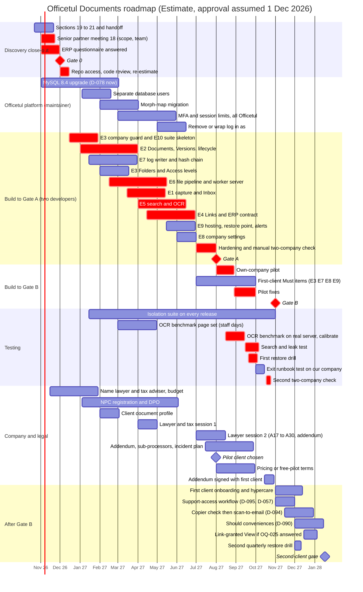

# 21 — Implementation Roadmap

## 1. Purpose

Lay out **what happens when**, from scope approval (Gate 0) to the second external client: the build order, testing, Officetul platform work, and the company and legal tasks that run alongside, plus what changes with one developer.

## 2. Status

**Owner agreed (Round 15, D-104, D-105, D-108, D-109), 2026-10-21.** Source: [R22](../research/R22-risk-register-and-roadmap.md) Part B. The timeline depends on the senior partner approving scope and two developers (D-089). **All dates are Estimates**, assuming approval on 1 December 2026.

## 3. Executive Summary

| Milestone | When |
|---|---|
| Gate 0 | Month 0 |
| Code review done | Month 1, week 2 |
| First end-to-end upload-to-open flow | End of month 4 |
| **Gate A**, own-company pilot | About month 8 (Aug 2027) |
| **Gate B**, first external client | About month 11 (Nov 2027) |
| Second-client gate (D-109) | About month 14 (Jan 2028) |

- **Build order (D-104):**
  1. company guard and isolation tests;
  2. Document model;
  3. log writer;
  4. file pipeline;
  5. capture and Inbox;
  6. search and OCR;
  7. Links;
  8. operations and admin.
- **Start now (D-105):**
  - check NPC registration and the DPO;
  - name the lawyer and the tax adviser;
  - send the questionnaire with the urgent items marked.

  NPC registration must start by month 3, and the lawyer must answer A23–A30 by month 9.
- **First client (D-108):**
  - not a law firm;
  - a medium or heavy paper load;
  - uses Officetul Expenses;
  - has a named admin;
  - not onboarded in the holiday season, Holy Week or (for accounting firms) tax season.

## 4–10. Plan

### 7. Assumptions

| # | Assumption | Label |
|---|---|---|
| 1 | Two full-time developers from M1 (D-089), about 7 productive developer-weeks a month (2 people × 4.3 weeks × 80%, R20 §4.1) | Estimate |
| 2 | Own-pilot Must work 49–72 developer-weeks; first-client Must work 16–26; Should work 9.5–16; all with 15% contingency (R20 §4.2) | Estimate |
| 3 | Gate A about 8 months after approval (7–10); Gate B about 3 months later (D-089) | Verified fact (target) |
| 4 | Officetul platform work (0.5–8 developer-weeks) is done by the Officetul maintainer, not the two developers (D-096) | Verified fact |
| 5 | **Calendar dates assume scope approval on 1 December 2026.** Shift every date by the real approval date. | Estimate |
| 6 | First-client Must items are built partly during the own pilot (R20 §4.5) | Estimate |

### 8. Gantt

Critical-path bars are marked `crit`. *(Estimate; calendar per assumption 5)*

### 9. Month by month

*(Estimate. Calendar per assumption 5. "Check" is what must be true at month end.)*

| Month | Calendar | Discovery and platform | Build (epics) | Testing | Company and legal | Check at month end |
|---|---|---|---|---|---|---|
| **Before M0** | Oct–Nov 2026 | Sections 19–21 and handoff; meeting guide 18 (scope, team); ERP questionnaire Q1–Q33; maintainer starts MySQL 8.4 (D-078 "now") | — | — | Senior partner names lawyer, tax adviser and budget (Q2); owner checks OQ-024 | **Gate 0** met |
| **M1** | Dec 2026 | Repository access; **code review and re-estimate in weeks 1–2** (D-013, RK-71); maintainer estimates all platform work (D-096) | E3 company guard, composite keys; E10 isolation-suite skeleton; E2 model start | Isolation suite runs from the first merge | Holiday dip from 15 Dec (RK-78) | Design confirmed; re-plan if over 10% |
| **M2** | Jan 2027 | Separate database users in progress | E2 Documents, Versions, write-once; E7 log writer | — | Lawyer and tax adviser named; NPC registration started | Guard and model merged with tests |
| **M3** | Feb 2027 | **Separate database users done** (needed by E7 grants) | E3 Folders and Access levels; E7 hash chain and insert-only grants; E6 worker server and containers start | — | Client document profile filled in (D-012) | Log entries chained on our test company |
| **M4** | Mar 2027 | Morph-map migration in progress | E6 quarantine → scan → promote; E1 resumable upload and Inbox | OCR benchmark pages gathered (5–8 staff days, D-050) | Lawyer and tax session 1 booked; Holy Week 25–26 Mar | **Walking skeleton:** upload → scan → Inbox → file → open, for one company, suite green |
| **M5** | Apr 2027 | **Morph map done** (needed by E4) | E6 previews and download domain; E5 OCR jobs, search table, access join, identifiers | — | **Session 1:** claims A1–A6, privacy A7–A12, A22; tax B1–B6 | Search returns only permitted Documents |
| **M6** | May 2027 | "Log in as" removal starts | E4 provider contract, Links, Documents panel, events; E5 snippets | — | Addendum outline from session 1 | Expense ↔ receipt Link works end to end |
| **M7** | Jun 2027 | **MySQL 8.4, MFA and sessions done** (Gate A items, D-096) | E4 expenses report, nightly check; E9 hosting, restore point, versioning, alerts; E8 company settings | Route sweep; architecture tests | Pilot client shortlist | All own-pilot Must items feature-complete |
| **M8** | Jul 2027 | — | Hardening; first-client Must items start (E7 digest, Fixity checks; E9 locked backups) | Isolation suite complete; **manual two-company check** | **Session 2:** A17–A30, addendum review; **pilot client chosen**; OQ-030 backup region settled | **Gate A** |
| **M9** | Aug 2027 | — | **Own-company pilot** (2–4 weeks, D-017); E8 export, exit runbook, purge ledger, restore marker | **OCR benchmark** on the real server; owner calibration session | Addendum, sub-processor list, incident procedure drafted; pricing meeting | Pilot exit report (§11) |
| **M10** | Sep 2027 | — | Pilot fixes; E3 Confidential folders, "Who can see this?", password re-entry; MFA required for admins | **Search and leak test** (D-068); **first restore drill** (D-085) | NPC registration confirmed; DPO named; pricing or free-pilot terms | Gate B readiness review |
| **M11** | Oct 2027 | — | Remaining first-client items; code-review findings closed | Exit runbook tested on our company; **second two-company check** | Addendum signed; tabletop exercise; claims reviewed or open items recorded as accepted risks | **Gate B** |
| **M12** | Nov 2027 | — | First-client onboarding and hypercare; Support-access workflow (D-095) | Isolation suite on every release | OQ-019 copier check at the client | First client live |
| **M13** | Dec 2027 | — | Scan-to-email (D-094); Should conveniences (D-090); link-granted View if OQ-025 is answered (D-093) | Second quarterly drill (early December) | Holiday dip (RK-78) | First client stable 6 weeks |
| **M14** | Jan 2028 | — | Next-release planning (§13) | — | Register review | **Second-client gate** (Q6) |

### 10. Critical path and dependencies

#### 10.1 What blocks what

**Critical path** *(Estimate)*: senior partner approval → ERP questionnaire and repository access → code review and re-estimate → **E3 company guard + E2 Document model** → **E6 file pipeline** (worker server, isolated tools) → **E1 capture** → **E5 search and OCR** → **E4 Links** → hardening, complete isolation suite, manual two-company check → **Gate A** → own pilot (2–4 weeks) → pilot fixes + **OCR benchmark on the real server + search and leak test + first restore drill** → second two-company check → **Gate B**.

| Item | Blocked by | Why |
|---|---|---|
| Every epic | Code review (D-013) | D-052, D-061, D-064 and D-075 are "subject to D-013 review" |
| Everything after E3 | Company guard (D-052) | Every query, job and command must fail closed from day one; retrofitting is where leaks come from |
| E7 insert-only grants | Separate database users (D-096, RK-39) | The app user must not be able to update log rows |
| E4 provider contract | Morph-map migration (D-096, RK-52) | Links store record types through the morph map |
| E5 search | E2 model, E3 access, E6 OCR text | Search joins access live (D-056) and indexes OCR text |
| OCR benchmark (D-050) | Worker server built (D-077); page set gathered | The benchmark runs on the real server class (RK-59) |
| Search and leak test (D-068) | Benchmark set; E3 Confidential folders | The leak check needs a Confidential folder |
| First restore drill (D-085) | Locked backups (D-080), purge ledger (D-084), backup region (OQ-030) | The drill proves the ledger replay and the targets (D-079) |
| Gate A | MySQL 8.4, MFA and sessions, "log in as" removed (D-096) | Platform work is a Gate A item |
| Addendum signing | Lawyer session 2; backup region named (D-080); pilot client chosen | The addendum names the region, sub-processors, exit terms |
| Gate B | NPC registration and DPO (OQ-024); pricing or free-pilot terms (OQ-020) | Company duties (D-032) and the client's terms |
| Second client | Support-access workflow (D-095) | D-057 must exist before client 2 |

#### 10.2 Earliest date each waiting item becomes blocking

"Must be done by" is the end of the month named. *(Estimate; calendar per assumption 5)*

| Waiting item | Who | Needed for | Must be done by | Calendar |
|---|---|---|---|---|
| Scope, team and budget approval (D-089); Section 01 sign-off | Senior partner | Everything | **M0** | Nov 2026 |
| ERP questionnaire, especially Q1–Q3, Q18–Q22, Q27–Q28 (OQ-008, OQ-025 part) | Officetul maintainer | Code review, guard design | **M0** | Nov 2026 |
| Both developers named and available | Senior partner | Build start | **M0** | Nov 2026 |
| OQ-028 MySQL version; upgrade plan | Officetul maintainer | Avoid Extended Support charges (D-078); Gate A | Answer M0; upgrade done **M7** | Nov 2026 / Jun 2027 |
| Repository access | Officetul maintainer | Code review in weeks 1–2 | **M1, week 1** | Dec 2026 |
| Q12 hosting and storage features (D-076) | Officetul maintainer | Bucket design | **M1** | Dec 2026 |
| Lawyer and tax adviser named, budget agreed (D-027) | Senior partner | Session 1 | **M2** | Jan 2027 |
| Separate database users (D-061, D-096) | Officetul maintainer | E7 grants | **M3** | Feb 2027 |
| NPC registration started (OQ-024) | Senior partner / owner | Gate B, with unknown NPC processing time | Start **M3**, confirmed **M10** | Feb / Sep 2027 |
| Client document profile (D-012) | Owner | Benchmark page mix; client shortlist | **M3** | Feb 2027 |
| Morph-map migration (D-075, D-096) | Officetul maintainer | E4 | **M5** | Apr 2027 |
| Lawyer A1–A12, A22; tax B1–B6 (session 1) | Lawyer, Tax adviser | Claims list, addendum draft, preset wording | **M5** | Apr 2027 |
| MFA and session limits; "log in as" removed (D-058, D-057, D-096) | Officetul maintainer | Gate A | **M7** | Jun 2027 |
| OCR benchmark page set (240 pages, D-050) | Owner and staff | Benchmark run | **M8** | Jul 2027 |
| OQ-030 backup region (Tokyo or Malaysia) | Owner | Locked backups; addendum | **M8** | Jul 2027 |
| Pilot client chosen (D-017) | Owner | Addendum; copier check | **M8** | Jul 2027 |
| **Lawyer A17–A30** (log retention, backups, exit, restore) | Lawyer | Exit runbook test, drill record, addendum exit terms | **M9** | Aug 2027 |
| Pricing (OQ-020, D-018) or free-pilot terms | Senior partner | First client's agreement | **M10** | Sep 2027 |
| Addendum signed; sub-processor list; incident procedure; tabletop (D-032, D-087) | Owner, Lawyer, Ops on-call | Gate B | **M11** | Oct 2027 |
| OQ-019 copier check | Owner (at the client) | Scan-to-email build (D-094) | **M12** | Nov 2027 |
| OQ-025 record visibility | Officetul maintainer | Link-granted View (D-093) | **M13** | Dec 2027 |
| OQ-027 PNPKI time-stamps | Research | Next release | Next-release planning | Jan 2028 |
| ISO goal (OQ-003, D-028) | Senior partner | Nothing in the MVP | — | — |

### 11. Milestones and exit criteria

| Milestone | When | Exit criteria | Gate link |
|---|---|---|---|
| **Gate 0: build may start** | M0 | Senior partner approves scope, ~8 months and two developers (D-089) and signs off Section 01; questionnaire answered; repository access granted; developers named | Section 17 §6.4 Gate 0 |
| **Design confirmed** | M1, week 2 | Code review held; D-052, D-061, D-064, D-075 defaults confirmed or changed; re-estimate within 10% of plan, or a re-plan agreed by the owner (RK-71) | Gate 0 (last item) |
| **Walking skeleton** | End of M4 | Upload → quarantine → clean verdict → Inbox → filed Document → opened preview, for one company; isolation suite green; Activity log entries chained | *Recommendation* (internal checkpoint) |
| **Gate A: own-company pilot** | End of M8 | All own-pilot Must items; isolation suite green and one manual two-company check (D-052, D-091); MySQL 8.4; hosting confirmed; processing server isolated; restore point and versioning on; alerts to named on-call people; platform work done (D-096); Inbox visibility (D-092); enough paper in our company (D-017) | Section 17 §6.4 Gate A |
| **Own pilot exit** | M9 | 2–4 weeks of use; no open blocking bug; pilot measures recorded (usage, event volume, ops hours, OCR backlog, Inbox age, share of Draft record types for RK-27 and RK-79); list of Should items requested, decided by the RK-83 rule | D-017; R20 10.4 |
| **Gate B: first external client** | End of M11 | Every Gate B item in Section 17 §6.4: technical (chain, digest, Fixity checks, locked backups, purge ledger, first drill, MFA, interim support policy, exit runbook tested), testing (D-050 benchmark, D-068 search and leak test), legal and privacy (NPC and DPO, addendum, sub-processor list, incident procedure, lawyer review or recorded accepted risks), approvals (pilot client, pricing or free-pilot terms, code-review findings closed) | Section 17 §6.4 Gate B |
| **First client stable** | M13 | 6 weeks live with no open blocking bug; no isolation or log-chain alert; Inbox items filed within the agreed time | *Recommendation* |
| **Second-client gate** | About M14 | Support-access workflow with break-glass (D-057) built and tested; second quarterly drill done; first client stable; register reviewed; scan-to-email built if the copier check passed | D-095; *Recommendation* (Q6) |

### 12. One developer instead of two

*(Estimate, from R20 §4.5–§4.6)*

| Item | Two developers | One developer |
|---|---|---|
| Productive capacity | about 7 developer-weeks a month | about 3.5 developer-weeks a month |
| Gate A | about M8 (7–10) | about **M14–M21** |
| Gate B | about M11 | about **M19–M28** |
| With the "thinner own pilot" (R20 §4.6: Office previews, activity filters, snippet page numbers, encrypted-file screen moved after Gate A) | about M7.5 | about M13–M19 for Gate A |

**What breaks besides the dates:**
- **Two-person duties** (R20 C-12):
  - break-glass needs two Officetul approvers (D-057), though the first client uses D-095 anyway;
  - the yearly rebuild must be done by someone who didn't write the runbook (D-085);
  - the on-call backup carries the 24-hour breach duty (D-087).

  A non-developer second person (the owner or the Officetul maintainer) must be trained for all three.
- **No second pair of eyes** on security-critical code. RK-42 and RK-77 rise from M/H to H/H.
- **Key-person risk doubles.** RK-73 now covers the developer as well as the owner.
- **Holiday seasons hit twice** before Gate B (RK-78).

**Recommendation for a one-developer fallback:**
1. Keep every security and integrity item; cut by sequence, not by safety (Section 17 §7).
2. Take the thinner own pilot.
3. Have the Officetul maintainer review guard, access-filter and log-writer code.
4. Buy an external penetration test before Gate B (Section 12 B3 lists it yearly as Should).
5. Re-run this roadmap with the real start date.

### 13. Next release candidates

From the out-of-scope list (Section 17 §6.2; R20 §2.1). **Recommendation** for the order; sizes are a rough **Estimate** (S about 2–4 developer-weeks, M 4–8, L 8+).

| Order | Candidate | Size | Why in this order |
|---|---|---|---|
| 0 | **Should items first** (D-090, D-093, D-094, D-095), and the accounting-firm pack if the first client is an accounting firm | S each | Already decided; D-095 is required before the second client |
| 1 | **Review and expiry reminders** (D-014, D-021) | S | Expiry and event dates are already captured (D-026). Permit and SEC GIS deadlines give daily value, which helps adoption (RK-01, RK-79). |
| 2 | **Retention rules, legal hold, blocked state, certified deletion, person-level search and access report**; governance-mode lock on Original files (D-033, D-041, D-073) | L | Privacy duties (NPC Circular 2023-06). Closes the gaps behind RK-29, RK-54, RK-55 and RK-65. Lawyer answers (A11, A23–A27, OQ-029) arrive by M9, so the design rests on advice. |
| 3 | **Approval chains** on "mark official" (D-037) | M | Controlled documents and ISO readiness (D-011); reduces RK-28; useful to construction and QA-minded clients |
| 4 | **Document requests, client portal, share links** (D-022) | L | Biggest commercial pull, especially for accounting firms collecting client papers. It adds outside users and a new attack surface, so it should follow retention (expiry) and the support workflow. |
| 5 | **Evidence pack and digest time-stamps** (RFC 3161, PNPKI if live; D-031, D-061, OQ-027) | M | Needs lawyer approval of the custodian-affidavit wording; demand appears only with a dispute |
| Later | Law and construction packs (D-025), AI extraction (metered, after pricing), e-signatures, Meilisearch on triggers (D-064) | — | Each waits for client mix, pricing or a measured trigger |

## 11–12. Questions and Decisions

Grilling Round 15, Q6, Q7, Q10, Q11.

## 13. Confirmed Decisions

| ID | Decision |
|---|---|
| D-089 | Two full-time developers; own pilot about 8 months after approval |
| D-104 | Build order |
| D-105 | Long-lead company tasks start now |
| D-108 | First external client criteria |
| D-109 | Second-client gate, agreed in writing with the senior partner |

## 14. Open Questions

- Senior partner approval of scope, team and pricing (meeting guide 18).
- Questionnaire answers and repository access (D-013).
- NPC registration and DPO (OQ-024); lawyer and tax adviser named (D-027).

## 15. Dependencies

Depends on Section 17 (scope, gates) and Section 19 (risks). Feeds the Phase 13 handoff: specification, tickets and the coding-agent implementation prompt.

## 16. Sources

R22 Part B (2026-10-21), R20 §4–§5.

## 17. Next Steps

- [x] Roadmap agreed by the owner
- [ ] November 2026: start the D-105 tasks
- [ ] Senior partner approves scope and team (Gate 0)
